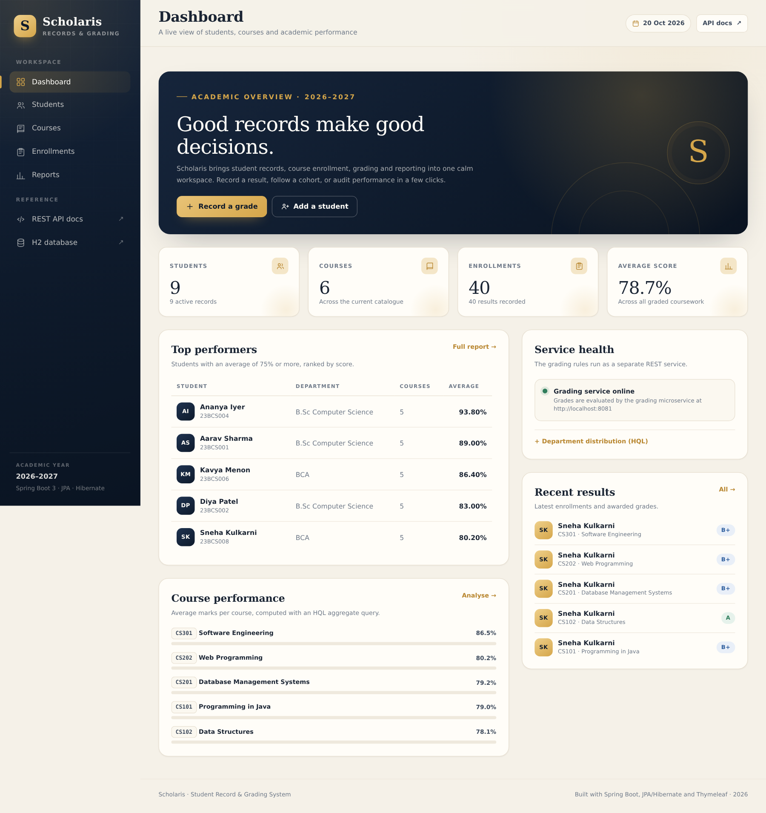
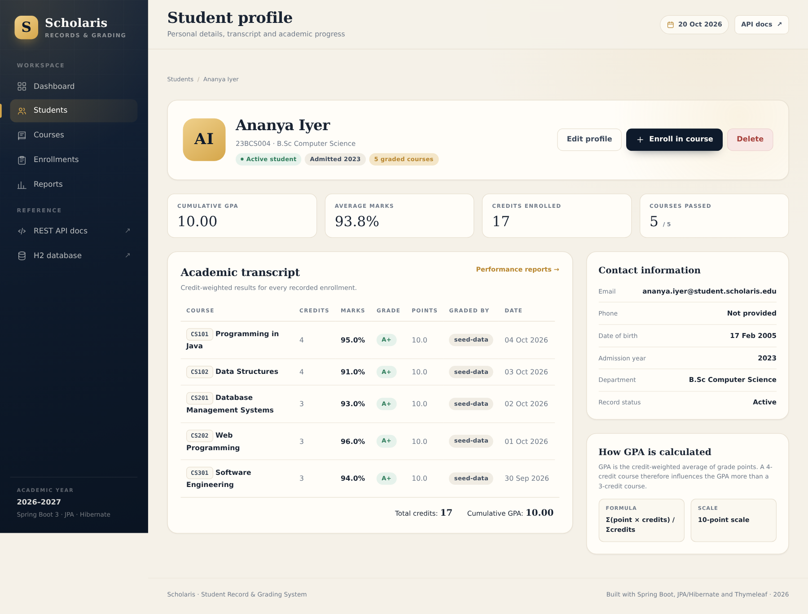
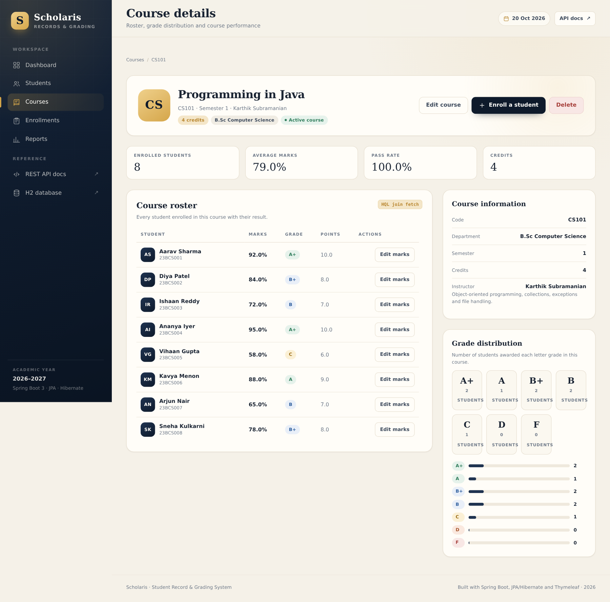
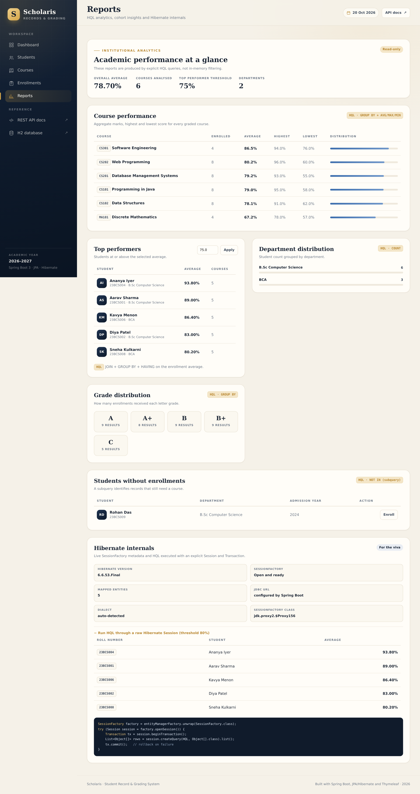
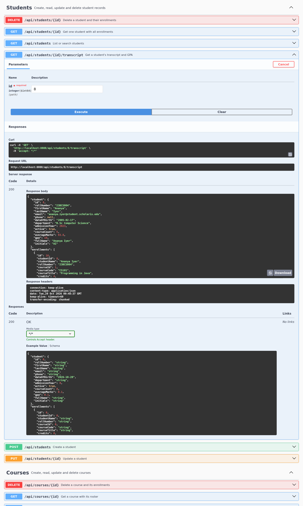
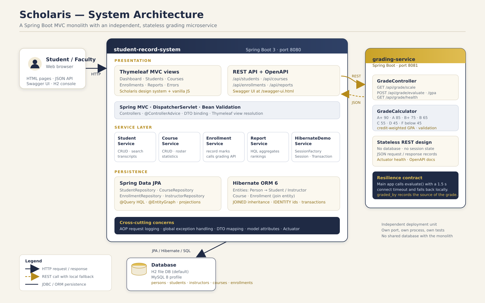
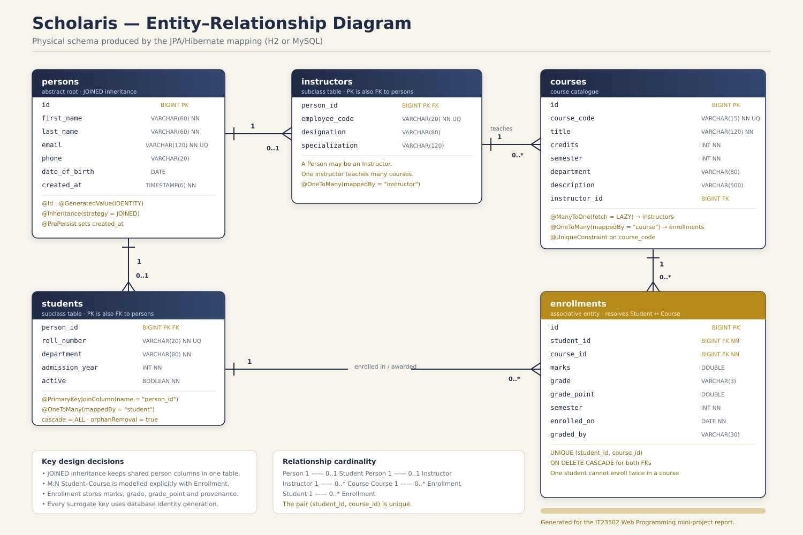

# Scholaris — Student Record and Grading System

A complete Spring Boot mini-project for **IT23502 Web Programming (Units IV & V)**. It manages students, instructors, courses, enrollments and grades through a Thymeleaf MVC interface, exposes a documented REST API, and delegates grade evaluation to an independent Spring Boot microservice running on a second port.

> **Repository:** <https://github.com/Senthil455/Student-Record-Grading-System>
>
> **Report:** [`docs/REPORT.pdf`](docs/REPORT.pdf) · **API guide:** [`docs/API.md`](docs/API.md) · **Viva notes:** [`docs/VIVA_NOTES.md`](docs/VIVA_NOTES.md)



---

## 1. What the application does

| Area | Capabilities |
| --- | --- |
| **Students** | Create, view, edit, delete; search by name, roll number or department; transcript, credit-weighted GPA, pass count |
| **Courses** | Full CRUD; instructor assignment; roster; grade distribution; pass rate; averages |
| **Enrollments** | Enroll a student in a course; record or correct marks; grades recalculated automatically; duplicate protection |
| **Reports** | Course performance, top performers (threshold), department distribution, grade distribution, students without enrollments |
| **REST API** | 23 endpoints with GET, POST, PUT and DELETE; consistent JSON error contract; OpenAPI/Swagger UI |
| **Grading service** | Independent REST service on port 8081: grade scale, mark evaluation, credit-weighted GPA |
| **Resilience** | If port 8081 is offline, the main application logs a warning and falls back to a local grade calculator |
| **Diagnostics** | Live SessionFactory metadata and an HQL query executed through an explicit `Session` + `Transaction` |
| **Quality** | 52 automated tests (unit, MVC, REST integration, repository HQL, inheritance mapping) |

### Screenshots

| Student profile and transcript | Course roster |
| --- | --- |
|  |  |

| Reports (HQL) | REST API testing (Swagger) |
| --- | --- |
|  |  |

All screenshots are in [`docs/screenshots/`](docs/screenshots/).

---

## 2. Architecture



- **`student-record-system`** (port **8080**) — Spring Boot MVC monolith with Thymeleaf, REST controllers, service layer, Spring Data JPA/Hibernate, H2 file database by default and a MySQL profile.
- **`grading-service`** (port **8081**) — stateless REST microservice that owns the institutional grading scale. It has no database and no session state.
- The main application calls the grading service with Spring's `RestClient`. A short timeout plus local fallback keeps the UI usable if the service is down.

More diagrams: [ER diagram](docs/diagrams/er-diagram.png) · [Request flow](docs/diagrams/request-flow.png) · [DevOps pipeline](docs/diagrams/devops-pipeline.png)

---

## 3. Technology stack

| Layer | Technology |
| --- | --- |
| Language / runtime | Java 17 (build tested on JDK 21), Spring Boot 3.5.16 |
| Web / MVC | Spring MVC, Thymeleaf, Bean Validation, vanilla CSS/JS |
| Persistence | Spring Data JPA, Hibernate ORM 6, H2 (default), MySQL 8 profile |
| REST | Spring Web, `RestClient`, springdoc-openapi 2.8.17, Swagger UI |
| Cross-cutting | Spring AOP (`@Aspect`, `@Around`), `@ControllerAdvice` |
| Build | Maven multi-module, Maven Wrapper |
| Tests | JUnit 5, Mockito, MockMvc, `@DataJpaTest`, `@SpringBootTest` |
| DevOps | Git/GitHub, GitHub Actions, Docker multi-stage build, Docker Compose |

---

## 4. Project structure

```
student-record-grading-system/
├── pom.xml                     # parent POM (two modules)
├── mvnw / mvnw.cmd             # Maven Wrapper
├── Dockerfile                  # shared multi-stage image for both modules
├── docker-compose.yml          # both services + persistent H2 volume
├── .github/workflows/ci.yml    # build, test and Docker image CI
├── database/
│   ├── schema.sql              # MySQL DDL
│   ├── schema-h2.sql           # H2 reference DDL
│   └── sample-data.sql         # 9 students, 6 courses, 40 enrollments
├── docs/
│   ├── REPORT.md / REPORT.pdf  # full mini-project report
│   ├── API.md                  # REST API reference with curl examples
│   ├── VIVA_NOTES.md           # viva preparation Q&A
│   ├── diagrams/               # architecture, ER, request flow, DevOps
│   └── screenshots/            # working-application and API evidence
├── postman/                    # collection + environment
├── grading-service/            # port 8081 — REST microservice
└── student-record-system/      # port 8080 — MVC + REST application
```

### Main application packages

```
com.example.studentrecord
├── domain        Person (abstract) → Student / Instructor, Course, Enrollment
├── repository    4 Spring Data JPA repositories with explicit HQL
├── service       Student, Course, Enrollment, Report, HibernateDemo
├── web           Thymeleaf MVC controllers + global model advice
├── api           REST controllers (students, courses, enrollments, reports, diagnostics)
├── dto           request/response records and projections
├── grading       GradingClient + LocalGradeCalculator fallback
├── config        AppConfig (RestClient bean), DataSeeder, OpenAPI metadata
├── aop           LoggingAspect
└── exception     custom exceptions + JSON/MVC error handlers
```

---

## 5. Run locally

### Prerequisites

- **Java 17 or newer** (`java -version`)
- No system Maven required — use the included wrapper
- Ports **8080** and **8081** free

### 5.1 Build and test

```bash
git clone https://github.com/Senthil455/Student-Record-Grading-System.git
cd Student-Record-Grading-System

./mvnw clean verify          # compiles, runs all 52 tests, packages both jars
```

Expected result: `BUILD SUCCESS`, 23 tests in `grading-service` and 29 in `student-record-system`.

### 5.2 Start both services

Open two terminals from the project root.

**Terminal 1 — grading microservice (start it first):**

```bash
./mvnw -pl grading-service spring-boot:run
```

**Terminal 2 — main application:**

```bash
./mvnw -pl student-record-system spring-boot:run
```

Alternative, using the packaged jars:

```bash
java -jar grading-service/target/grading-service-1.0.0.jar
java -jar student-record-system/target/student-record-system-1.0.0.jar
```

| URL | Purpose |
| --- | --- |
| <http://localhost:8080> | Scholaris dashboard |
| <http://localhost:8080/swagger-ui.html> | Main REST API docs / testing |
| <http://localhost:8081/swagger-ui.html> | Grading service API docs |
| <http://localhost:8080/h2-console> | H2 database console |
| <http://localhost:8080/actuator/health> | Main health endpoint |
| <http://localhost:8081/api/grade/health> | Grading service health |

**H2 console login:** JDBC URL `jdbc:h2:file:./data/studentdb`, user `sa`, empty password.

The first run seeds **9 students, 4 instructors, 6 courses and 40 enrollments** into `student-record-system/data/`. To reset the demo data, stop the main application and delete that directory; it is recreated on the next start.

### 5.3 Run with Docker (one command)

```bash
docker compose up --build
```

This builds both images, starts the grading service first with a health check, then starts the main application connected to `http://grading-service:8081` on the Compose network. Student data persists in the `scholaris-student-data` volume.

### 5.4 Use MySQL instead of H2

```bash
mysql -u root -p < database/schema.sql
mysql -u root -p student_grading < database/sample-data.sql

SPRING_PROFILES_ACTIVE=mysql \
SPRING_DATASOURCE_USERNAME=root \
SPRING_DATASOURCE_PASSWORD=yourpassword \
java -jar student-record-system/target/student-record-system-1.0.0.jar
```

Or edit `student-record-system/src/main/resources/application-mysql.properties`. The schema also matches what Hibernate generates with `ddl-auto=update`.

---

## 6. REST API at a glance

Base URL: `http://localhost:8080`

| Method | Endpoint | Purpose |
| --- | --- | --- |
| GET | `/api/students` | List students (optional `?q=`) |
| GET | `/api/students/{id}` | Student with enrollments |
| GET | `/api/students/{id}/transcript` | Transcript, GPA and pass count |
| POST | `/api/students` | Create student |
| PUT | `/api/students/{id}` | Update student |
| DELETE | `/api/students/{id}` | Delete student and enrollments |
| GET | `/api/courses` | List courses (optional `?q=`) |
| GET | `/api/courses/{id}` | Course with roster |
| POST / PUT / DELETE | `/api/courses[/{id}]` | Course CRUD |
| GET | `/api/enrollments` | List enrollments |
| GET | `/api/enrollments/{id}` | One enrollment |
| POST | `/api/enrollments` | Enroll and grade via port 8081 |
| PUT | `/api/enrollments/{id}` | Correct marks and re-grade |
| DELETE | `/api/enrollments/{id}` | Remove enrollment |
| GET | `/api/reports/{summary,top-performers,course-performance,department-distribution,grade-distribution}` | HQL reports |
| GET | `/api/diagnostics/session-factory` | SessionFactory metadata |
| GET | `/api/diagnostics/hibernate/top-performers?minAverage=80` | Explicit Session + Transaction HQL |

Grading service base URL: `http://localhost:8081`

| Method | Endpoint | Purpose |
| --- | --- | --- |
| GET | `/api/grade/scale` | Grade bands |
| POST | `/api/grade/evaluate` | `{ "marks": 92 }` → `A+`, 10 points |
| POST | `/api/grade/gpa` | Credit-weighted GPA |
| GET | `/api/grade/health` | Health |

Quick checks:

```bash
curl http://localhost:8080/api/students
curl http://localhost:8080/api/students/8/transcript
curl -X POST http://localhost:8081/api/grade/evaluate \
  -H 'Content-Type: application/json' -d '{"marks":92}'
```

The complete contract, validation rules, error responses and curl examples are in [`docs/API.md`](docs/API.md). Import [`postman/Scholaris.postman_collection.json`](postman/Scholaris.postman_collection.json) and the matching environment into Postman to run the same requests interactively.

---

## 7. Database and sample data



- `persons` is the **JOINED inheritance** root for `students` and `instructors`.
- `enrollments` is the associative entity for the **many-to-many** student–course relationship; it also stores marks, letter grade, grade point, semester, date and grading source.
- All surrogate keys use `GenerationType.IDENTITY`.
- Unique constraints protect email, roll number, employee code, course code and the `(student_id, course_id)` pair.

Schema and inserts: [`database/`](database/). Sample data highlights:

| Roll number | Student | Department | Courses | Average |
| --- | --- | --- | --- | --- |
| 23BCS004 | Ananya Iyer | B.Sc Computer Science | 5 | 93.80% |
| 23BCS001 | Aarav Sharma | B.Sc Computer Science | 5 | 89.00% |
| 23BCS006 | Kavya Menon | BCA | 5 | 86.40% |
| 23BCS009 | Rohan Das | B.Sc Computer Science | 0 | — (exercises the HQL “no enrollments” query) |

---

## 8. Spring/Hibernate concepts demonstrated

| Requirement | Where to look |
| --- | --- |
| MVC | `web/StudentController`, `CourseController`, `EnrollmentController`, `ReportController`; Thymeleaf templates |
| JPA/Hibernate entities + CRUD | `domain/` and `repository/`; services use `save`, `findById`, `delete` |
| ORM mapping | `@OneToMany`, `@ManyToOne`, `@JoinColumn`, `mappedBy`, cascade/orphan removal |
| ID generation | `@GeneratedValue(strategy = GenerationType.IDENTITY)` in `Person`, `Course`, `Enrollment` |
| Inheritance | `Person` with `@Inheritance(strategy = JOINED)`; `Student`/`Instructor` with `@PrimaryKeyJoinColumn` |
| HQL (5 queries) | top performers, students without enrollments, department counts, course statistics, grade counts |
| SessionFactory / Session / Transaction | `service/HibernateDemoService` + `/api/diagnostics/*` + Reports page |
| Dependency injection | Constructor injection throughout; `AppConfig.gradingRestClient` bean; `ApplicationContext` manages all beans |
| AOP logging | `aop/LoggingAspect` — `@Around` on services, logs entry, duration, exceptions |
| REST GET/POST/PUT/DELETE | `api/` controllers; tested with MockMvc and Swagger/Postman |
| Microservice | `grading-service` on port 8081; `GradingClient` uses `RestClient` |
| Resilience | Local fallback + `graded_by` provenance field; dashboard health card |
| DevOps | Maven wrapper, Git/GitHub, GitHub Actions, Docker Compose |

Detailed explanations and code snippets are in [`docs/REPORT.md`](docs/REPORT.md); likely viva questions are answered in [`docs/VIVA_NOTES.md`](docs/VIVA_NOTES.md).

---

## 9. Testing

```bash
./mvnw test
```

| Module | Test class | What it proves |
| --- | --- | --- |
| grading-service | `GradeCalculatorTest` | 18 boundary/band/GPA cases |
| grading-service | `GradeControllerTest` | REST contract, validation, health |
| main | `LocalGradeCalculatorTest` | Offline fallback scale |
| main | `RepositoryHqlTest` | JOINED inheritance persistence + HQL queries |
| main | `MvcControllerIntegrationTest` | Thymeleaf pages, create/search, 404 handling |
| main | `RestApiIntegrationTest` | GET/POST/PUT/DELETE, transcript, validation, conflict, diagnostics |

A real API transcript is captured in [`docs/api-test-output.txt`](docs/api-test-output.txt), and endpoint testing is visible in [`docs/screenshots/swagger-api-test.png`](docs/screenshots/swagger-api-test.png).

---

## 10. Documentation map

| Document | Contents |
| --- | --- |
| [`docs/REPORT.pdf`](docs/REPORT.pdf) | Submission-ready report: problem, objectives, design, implementation, API, microservices, DevOps, results |
| [`docs/REPORT.md`](docs/REPORT.md) | Editable Markdown source of the report |
| [`docs/API.md`](docs/API.md) | Endpoint reference, request/response bodies, errors, curl |
| [`docs/VIVA_NOTES.md`](docs/VIVA_NOTES.md) | Short answers for the demonstration and viva |
| [`docs/Scholaris-Presentation.pptx`](docs/Scholaris-Presentation.pptx) | Presentation deck for the demo |
| [`postman/`](postman/) | Postman collection + environment |
| [`database/`](database/) | Schema and sample records |

---

## 11. Team

| Name | Register number | Contribution |
| --- | --- | --- |
| Senthil Raja R | _to be filled_ | Application architecture, backend, UI, tests, documentation |
| _Team member 2_ | _to be filled_ | _to be filled_ |
| _Team member 3_ | _to be filled_ | _to be filled_ |

> Replace the placeholders in this table, the report cover page and the presentation before uploading to the submission drive.

---

## 12. License

Released under the [MIT License](LICENSE). The sample student names and marks are fictional and created for demonstration.
