<div class="cover">
  <div class="cover-hero">
    <div class="cover-kicker">IT23502 &middot; Web Programming &middot; Mini-Project</div>
    <div class="cover-units">Units IV &amp; V &middot; Advanced Frameworks and Web Services</div>
    <div class="cover-mark">S</div>
    <div class="cover-title">Scholaris</div>
    <div class="cover-subtitle">Student Record and Grading System</div>
    <div class="cover-line"></div>
    <p class="cover-abstract">
      A Spring Boot MVC application for managing students, instructors, courses,
      enrollments and results, with a documented REST API and an independent
      grading microservice running on a second port.
    </p>
  </div>

  <div class="cover-details">
    <table class="cover-meta">
      <tr><th>Course</th><td>IT23502 &mdash; Web Programming</td></tr>
      <tr><th>Project type</th><td>Mini-project, Batch 2</td></tr>
      <tr><th>Academic year</th><td>2026&ndash;27</td></tr>
      <tr><th>Repository</th><td><span class="mono">github.com/Senthil455/Student-Record-Grading-System</span></td></tr>
      <tr><th>Submission date</th><td>October 2026</td></tr>
    </table>

    <table class="team-table">
      <thead>
        <tr><th>Team member</th><th>Register number</th><th>Contribution</th></tr>
      </thead>
      <tbody>
        <tr><td>Senthil Raja R</td><td class="blank">____________________</td><td>Architecture, backend, REST API, UI, tests and documentation</td></tr>
        <tr><td class="muted">Team member 2 (if applicable)</td><td class="blank">____________________</td><td class="muted">To be completed before submission</td></tr>
        <tr><td class="muted">Team member 3 (if applicable)</td><td class="blank">____________________</td><td class="muted">To be completed before submission</td></tr>
      </tbody>
    </table>

    <p class="cover-note">
      Register numbers and any additional team members must be completed before the report is uploaded.
      The implementation, screenshots and test evidence in this document are from the working project in the repository above.
    </p>
  </div>
</div>

<div class="page-break"></div>

<div class="toc-title">Contents</div>

[TOC]

# 1. Abstract {#abstract}

**Scholaris** is a web-based student record and grading system built with Spring Boot for the IT23502 Web Programming mini-project. It replaces scattered spreadsheets and paper registers with a single application in which an institution can maintain student and instructor records, offer courses, enroll students, record marks, calculate grades and produce academic reports. The user interface is server-rendered with Spring MVC and Thymeleaf, while the same business services are exposed through a JSON REST API documented with OpenAPI and Swagger UI.

The application deliberately demonstrates the concepts covered in Units IV and V rather than merely using them indirectly. It contains a JPA/Hibernate domain model with `@OneToMany`, `@ManyToOne`, `@JoinColumn`, cascade rules and a `JOINED` inheritance hierarchy (`Person` &rarr; `Student`/`Instructor`). Every surrogate key uses `GenerationType.IDENTITY`. Five explicit HQL queries power the reports: top performers, students without enrollments, department distribution, course performance and grade distribution. A separate diagnostics service opens a Hibernate `SessionFactory`, obtains a `Session`, begins a `Transaction`, runs HQL, commits and closes the session, making the roles of these objects observable at runtime. Constructor injection, an `ApplicationContext`-managed `RestClient` bean and an AOP logging aspect demonstrate Spring's dependency injection and cross-cutting concerns.

The grading rules are deliberately placed in a second Spring Boot application, `grading-service`, listening on port **8081**. The main application calls it through Spring's `RestClient`; the response contains the letter grade and grade point, which are persisted with the enrollment. If the second service is unavailable, a short timeout triggers a local fallback so that a lecturer can still save marks, and the `graded_by` column records whether the result came from the service or the fallback. This provides a small but genuine REST-based interaction between two independently runnable services.

The project is built as a Maven multi-module reactor, tested with 52 automated tests, packaged as executable JARs, containerised with a multi-stage Dockerfile and Docker Compose, and checked by a GitHub Actions workflow. The report explains the design decisions, shows the database schema and sample records, documents the API and testing evidence, and discusses REST versus SOAP, monolithic versus microservice architecture, the purpose of Spring Cloud, and the DevOps practices used to deliver the project.

**Keywords:** Spring Boot, Spring MVC, JPA, Hibernate, HQL, Thymeleaf, REST, microservices, Spring Cloud, AOP, Maven, DevOps, Docker.

# 2. Problem Statement and Motivation {#problem}

## 2.1 The problem

Educational institutions generate a large amount of structured information every semester: personal details, roll numbers, departments, course offerings, instructor allocations, enrollments, marks and grades. In many small institutions this information is still maintained in separate spreadsheets, departmental registers or ad-hoc databases. Such an arrangement creates several practical problems.

1. **Duplicate and inconsistent records.** The same student may appear in a class list, a marks sheet and a fee register with different spellings, roll numbers or email addresses. There is no single source of truth.
2. **Manual grade calculation.** Converting marks to letter grades, grade points and a credit-weighted GPA is repetitive and error-prone. Different faculty members may apply slightly different thresholds or rounding rules.
3. **Slow reporting.** Producing a list of top performers, counting students by department or comparing course averages requires copying data between files. The results are difficult to reproduce and easy to misread.
4. **No controlled access to data.** A spreadsheet can be copied, overwritten or lost. There is no validation, no referential integrity and no audit trail.
5. **Poor interoperability.** A modern institution may want a mobile app, a dashboard or an external examination system to consume the same data. A spreadsheet cannot provide a stable programmatic interface.
6. **No separation of concerns.** When presentation, business rules and database code are mixed in one file or one screen, a change to a grade boundary can break a report or a form.

A suitable solution is a central web application with a relational database, a clear domain model, server-side validation and a documented API. The application should be small enough for a one-week mini-project but complete enough to demonstrate the frameworks studied in Units IV and V.

## 2.2 Why a student record and grading system

A student record system is a good vehicle for the assignment because it naturally requires every concept in the syllabus:

- **Entities and relationships.** Students, instructors, courses and enrollments have meaningful one-to-many and many-to-many relationships.
- **CRUD.** Records must be created, viewed, edited and deleted.
- **Business rules.** Marks must be between 0 and 100; duplicate enrollments must be rejected; a course code and a roll number must be unique.
- **Aggregation and reporting.** Averages, counts, rankings and distributions require aggregate queries, which can be expressed cleanly in HQL.
- **Inheritance.** Students and instructors share personal details but have different academic or employment attributes, which is a realistic inheritance hierarchy.
- **REST and microservices.** Grade evaluation is a self-contained rule that can be moved into a second service and called over HTTP.
- **DevOps.** The project can be built, tested, containerised and delivered through a repeatable pipeline.

The domain is also easy to explain during a viva: every table and every screen has an obvious academic meaning.

## 2.3 Motivation for the chosen architecture

The project uses a **modular monolith plus one microservice** rather than a fully distributed system. The student, course and enrollment data is highly connected: an enrollment references both a student and a course, and a transcript needs all three. Keeping this transactional core in one Spring Boot application avoids distributed transactions and keeps the demonstration understandable. Grade evaluation, by contrast, is a stateless function of marks and a grade scale. It has no database and no session state, so it can be isolated cleanly in a second service. This hybrid is a realistic first step from a monolith towards microservices: the boundary is chosen where it adds value, not simply to use more technologies.

# 3. Objectives {#objectives}

## 3.1 Primary objective

To design, implement, test and document a working Spring Boot web application that manages student records and grades, demonstrates the Unit IV and Unit V concepts, and can be run locally by another person using the instructions in this report.

## 3.2 Specific objectives

The project sets out to achieve the following specific objectives.

| # | Objective | Evidence in the project |
| --- | --- | --- |
| O1 | Build a Spring Boot MVC application with a clean controller &rarr; service &rarr; repository layering | `web/`, `service/`, `repository/` packages; Thymeleaf pages |
| O2 | Persist data through JPA/Hibernate with annotated entities and full CRUD | `domain/` entities; services using `save`, `findById`, `delete`; CRUD screens |
| O3 | Demonstrate ORM relationships and a suitable identifier strategy | `@OneToMany`, `@ManyToOne`, `@JoinColumn`, `mappedBy`, cascade; `GenerationType.IDENTITY` |
| O4 | Implement at least two meaningful HQL queries | Five HQL reports plus one explicit `Session` query |
| O5 | Demonstrate inheritance mapping | `Person` &rarr; `Student`/`Instructor` using `InheritanceType.JOINED` |
| O6 | Explain SessionFactory, Session and Transaction in a running application | `HibernateDemoService` and `/api/diagnostics/*` |
| O7 | Demonstrate dependency injection and the role of the ApplicationContext | Constructor injection, `@Service`, `@Bean RestClient`, Spring Boot context |
| O8 | Apply AOP to a practical cross-cutting concern | `LoggingAspect` around all service methods |
| O9 | Develop a REST API with at least GET and POST, and test it | 23 main-app endpoints; Swagger, Postman and MockMvc evidence |
| O10 | Build a second Spring Boot service and demonstrate REST interaction | `grading-service` on port 8081 called through `RestClient` |
| O11 | Explain and apply DevOps practices | Git/GitHub, Maven Wrapper, GitHub Actions, Docker Compose |
| O12 | Produce a report, screenshots, schema and run instructions | This report, `docs/`, `database/`, `postman/`, `README.md` |

## 3.3 Learning objectives

By completing the project, the team aimed to be able to:

- explain how a request travels through `DispatcherServlet`, a controller, a service and a repository;
- explain the difference between JPA and Hibernate, and between `EntityManager` and `Session`;
- write HQL that uses joins, aggregate functions, `GROUP BY`, `HAVING`, subqueries and projections;
- choose an inheritance strategy and an identifier generation strategy with reasons;
- design REST resources, choose HTTP methods and status codes, and validate request bodies;
- explain why a second service may be useful, how it is called, and how failure is handled;
- describe a build pipeline from a local commit to a tested and packaged artifact;
- demonstrate the application confidently and answer questions about any part of the code.

# 4. Scope and Features {#scope}

## 4.1 Users and use cases

The application is intended for academic office staff and faculty members. It does not implement authentication in this version; the scope is record management and framework demonstration. The main use cases are:

- **Manage students:** add a student, search the register, open a profile, edit details, delete a record and view a transcript.
- **Manage courses:** create a course, assign an instructor, view the roster, edit the course and delete it.
- **Manage enrollments:** enroll a student in a course, record marks and correct marks later.
- **View reports:** top performers above a threshold, course performance, department distribution, grade distribution and students without enrollments.
- **Use the API:** perform the same operations programmatically and inspect the OpenAPI contract.
- **Demonstrate Hibernate:** inspect the `SessionFactory` metadata and run HQL through an explicit `Session` and `Transaction`.
- **Observe service health:** see whether the grading service is online and whether a result came from the service or the local fallback.

## 4.2 Functional features

| Module | Features |
| --- | --- |
| **Dashboard** | Counts of students, active students, courses, enrollments and graded enrollments; overall average; top five performers; course averages; recent enrollments; department distribution; grading-service status |
| **Students** | List, search by name/roll number/department, create, detail, edit, delete; date of birth, admission year, active flag; transcript with credits, pass count, average and credit-weighted GPA |
| **Instructors** | Seeded and used for course assignment; instructor options appear in the course form; no separate CRUD screen in this version |
| **Courses** | List, search, create, detail, edit, delete; course code, title, credits, semester, department, description, instructor; roster, grade distribution and pass rate |
| **Enrollments** | List, create, edit marks, delete; duplicate protection; automatic grade and grade-point calculation; source of grading recorded |
| **Reports** | Top performers with a configurable minimum average; course statistics; department counts; grade distribution; students without enrollments; explicit Hibernate demonstration |
| **REST API** | Student, course, enrollment and report resources; GET, POST, PUT, DELETE; search parameters; validation and consistent errors |
| **Grading service** | Grade scale, mark evaluation, credit-weighted GPA, health and service information |
| **Diagnostics** | SessionFactory details and an HQL query executed with `openSession()`, `beginTransaction()`, `commit()` and `close()` |
| **Documentation** | OpenAPI/Swagger UI, README, API reference, viva notes, Postman collection and this report |

## 4.3 Out of scope

The following items are intentionally excluded so that the project remains understandable and can be completed within the assignment window:

- user authentication, authorization and password management;
- fee management, attendance, timetable and examination scheduling;
- file uploads, email notifications and SMS integration;
- production-grade secrets management, TLS termination and database migrations with Flyway/Liquibase;
- a full instructor CRUD interface (instructors are seeded and assigned to courses);
- distributed transactions, message queues and service discovery;
- native mobile clients.

These are natural future enhancements, not missing core requirements.

## 4.4 Assumptions

- A student is identified by a unique roll number and email address.
- A course is identified by a unique course code.
- A student may enroll in a course at most once; the pair `(student_id, course_id)` is unique.
- Marks are percentages in the inclusive range 0&ndash;100.
- The grade scale is institutional policy and is owned by the grading service.
- One instructor may teach several courses; a course may have zero or one instructor.
- The default demo data is fictional and is created only when the database is empty.

# 5. Requirements Analysis {#requirements}

## 5.1 Functional requirements

| ID | Requirement | Acceptance criterion |
| --- | --- | --- |
| FR1 | The system shall display a dashboard with current totals and academic highlights. | The page loads with counts, averages and recent activity from the database. |
| FR2 | The system shall list and search students. | A query matches first name, last name, roll number or department, case-insensitively. |
| FR3 | The system shall create, read, update and delete students. | Each operation is available from the UI and the REST API, with validation and appropriate status codes. |
| FR4 | The system shall list and search courses and show a roster. | Course detail shows instructor, enrolled students, grade counts and pass rate. |
| FR5 | The system shall create, read, update and delete courses. | Duplicate course codes are rejected with a readable message. |
| FR6 | The system shall enroll a student in a course and record marks. | The grade and grade point are calculated and stored; duplicate enrollment is rejected. |
| FR7 | The system shall allow marks to be corrected. | Updating marks recalculates the grade, grade point and grading source. |
| FR8 | The system shall produce academic reports. | Top performers, course statistics, department distribution and grade distribution are available in the UI and API. |
| FR9 | The system shall expose a documented REST API. | OpenAPI JSON and Swagger UI are reachable; all endpoints return JSON and a consistent error body. |
| FR10 | The system shall call the grading service for grade evaluation. | A successful call stores `gradedBy = grading-service`; an unavailable service stores `local-fallback` after a timeout. |
| FR11 | The system shall demonstrate Hibernate internals. | `/api/diagnostics/session-factory` returns metadata and `/api/diagnostics/hibernate/top-performers` runs explicit HQL. |
| FR12 | The system shall run on two ports and be reproducible. | The main application runs on 8080, the grading service on 8081, and Maven/Docker instructions start both. |

## 5.2 Non-functional requirements

| ID | Requirement | How it is addressed |
| --- | --- | --- |
| NFR1 | **Usability.** The UI should be clear and consistent. | Shared layout fragment, sidebar navigation, consistent cards, tables, forms, flash messages and empty states. |
| NFR2 | **Data integrity.** Invalid or duplicate data must not be stored. | Bean Validation, service-level duplicate checks, unique constraints and foreign keys. |
| NFR3 | **Maintainability.** Responsibilities should be separated. | Controller/service/repository layers, DTOs, custom exceptions, central exception handlers. |
| NFR4 | **Performance.** List pages should avoid the N+1 query problem. | `@EntityGraph` and explicit join-fetch queries; `open-in-view` disabled. |
| NFR5 | **Resilience.** A grading-service failure must not block mark entry. | Short client timeouts, local fallback, visible service status and `graded_by` provenance. |
| NFR6 | **Testability.** Core behaviour should be covered by automated tests. | 52 tests across unit, MVC, REST, repository and inheritance concerns. |
| NFR7 | **Portability.** The project should run without a pre-installed Maven or database server. | Maven Wrapper, H2 file database by default, MySQL profile as an option. |
| NFR8 | **Documentation.** Another developer should be able to run and understand the project. | README, API reference, OpenAPI, viva notes, schema scripts, Postman collection and this report. |
| NFR9 | **Observability.** It should be possible to see what the application is doing. | SLF4J logs, AOP timing logs, Actuator health endpoint and grading-service health card. |
| NFR10 | **Deployability.** The application should be packageable and containerisable. | Executable JARs, multi-stage Dockerfile and Docker Compose with health checks. |

## 5.3 Constraints

- Java 17 language level; the build was verified on JDK 21 with `--release 17` semantics from the Spring Boot parent.
- Spring Boot 3.5.x, which uses Jakarta EE namespaces (`jakarta.persistence`, `jakarta.validation`).
- A single one-week assignment window, so the feature set is intentionally focused.
- No external cloud services are required for the demonstration; everything runs locally.
- The H2 file database is suitable for a demonstration but not for concurrent production use.

# 6. System Design {#design}

## 6.1 Architecture


The system has three runtime parts:

1. **Browser / API client.** A user opens the Thymeleaf UI, while Postman, Swagger UI or curl can call the REST API. Both ultimately reach the same Spring Boot process on port 8080.
2. **`student-record-system` (port 8080).** A Spring Boot application containing the MVC layer, REST controllers, service layer, repositories and the H2/MySQL database access. It owns the persistent academic data.
3. **`grading-service` (port 8081).** A small stateless Spring Boot application that applies the grade scale. It has no database. The main application calls it over HTTP with `RestClient`.

The main application is a **modular monolith**: all persistent academic data and its transactional rules live in one deployable unit. The grading service is a **microservice** because it has a separate process, port, build artifact and deployment lifecycle, and communicates only through a REST contract. This hybrid keeps the core simple while satisfying the requirement for a second independent service.

### 6.1.1 Layered structure

| Layer | Responsibility | Main classes |
| --- | --- | --- |
| Presentation (MVC) | Render HTML, handle form submissions, flash messages and error pages | `HomeController`, `StudentController`, `CourseController`, `EnrollmentController`, `ReportController`, Thymeleaf templates |
| Presentation (REST) | Expose JSON resources, status codes and OpenAPI metadata | `StudentApiController`, `CourseApiController`, `EnrollmentApiController`, `ReportApiController`, `DiagnosticsApiController` |
| Application / service | Business rules, transactions, duplicate checks, grade orchestration, DTO assembly | `StudentService`, `CourseService`, `EnrollmentService`, `ReportService`, `HibernateDemoService` |
| Persistence | Entity mapping and data access | `StudentRepository`, `CourseRepository`, `EnrollmentRepository`, `InstructorRepository` |
| Domain | Persistent entities and relationships | `Person`, `Student`, `Instructor`, `Course`, `Enrollment` |
| Integration | Call the second service and provide resilience | `GradingClient`, `LocalGradeCalculator`, `GradeResult` |
| Cross-cutting | Logging, validation, exception handling, configuration | `LoggingAspect`, `ApiExceptionHandler`, `WebExceptionHandler`, `AppConfig`, `OpenApiConfig` |

The dependency direction is downward: controllers depend on services, services depend on repositories and the grading client, and repositories depend on the JPA `EntityManager`. Entities do not depend on controllers. This makes the business logic testable without the web layer.

### 6.1.2 Why this architecture

- **Separation of concerns.** A change to a Thymeleaf page does not affect the REST contract, and a change to a query does not affect the controllers.
- **Single source of truth.** Both the UI and the API use the same services, so business rules are implemented once.
- **Testability.** `@DataJpaTest` can test repositories without starting the web server; MockMvc can test controllers without a browser; the grading service can be tested independently.
- **Clear microservice boundary.** Grading is a pure rule with no shared database, so it can be extracted without distributed transactions.
- **Deployability.** Each module produces an executable JAR. Docker Compose starts both with one command and a health-check dependency.

## 6.2 Module decomposition

The Maven reactor contains a parent POM and two child modules.

```
student-record-grading-system/
├── pom.xml                       parent: Java 17, Spring Boot 3.5.16, two modules
├── mvnw, mvnw.cmd                Maven Wrapper (no system Maven required)
├── student-record-system/        port 8080: MVC + REST + JPA
├── grading-service/              port 8081: stateless grading API
├── database/                     MySQL and H2 DDL, sample inserts
├── docs/                         report, API guide, viva notes, diagrams, screenshots
├── postman/                      collection and environment
├── Dockerfile                    shared multi-stage build
├── docker-compose.yml            both services + persistent H2 volume
└── .github/workflows/ci.yml      build, test and image build
```

Inside `student-record-system`, the package structure mirrors the layers:

```
com.example.studentrecord
├── domain/        Person, Student, Instructor, Course, Enrollment
├── repository/    Spring Data JPA interfaces and HQL
├── service/       transactional business logic and reporting
├── web/           MVC controllers, global model advice, HTML error handler
├── api/           REST controllers
├── dto/           request records, response records and projections
├── grading/       RestClient integration and local fallback
├── config/        RestClient bean, seeding, OpenAPI metadata
├── aop/           logging aspect
└── exception/     custom exceptions and JSON error contract
```

The `grading-service` is intentionally small:

```
com.example.gradingservice
├── service/GradeCalculator       grade bands, evaluation, GPA
├── web/GradeController           /api/grade/*
├── web/ApiExceptionHandler       JSON errors
└── dto/                          request and response records
```

## 6.3 Request flow

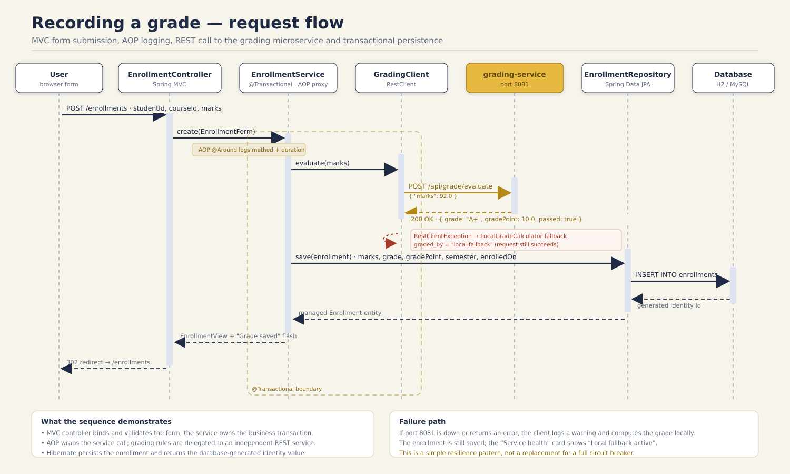

### 6.3.1 MVC request

1. The browser sends `GET /students/8`.
2. Spring Boot's embedded Tomcat passes the request to the `DispatcherServlet`.
3. `DispatcherServlet` asks the handler mapping for a controller method; it selects `StudentController.detail(8, model)`.
4. The controller calls `StudentService.findDetail(8)`.
5. The service opens a read-only transaction (through a Spring proxy), calls `StudentRepository.findDetailedById(8)` and maps the entity graph to a `StudentDetail` DTO.
6. The controller adds the DTO to the `Model` and returns the view name `students/detail`.
7. Thymeleaf's view resolver renders `templates/students/detail.html` with the model.
8. The HTML response returns to the browser.

If the student does not exist, the service throws `ResourceNotFoundException`. `WebExceptionHandler` catches it, sets HTTP 404 and renders `error/404.html` with a friendly message.

### 6.3.2 REST request

1. A client sends `POST /api/enrollments` with JSON.
2. `DispatcherServlet` selects `EnrollmentApiController.create(...)`.
3. `@Valid` triggers Bean Validation on the `EnrollmentRequest` record. A failure is converted by `ApiExceptionHandler` into a 400 response with field errors.
4. The controller converts the request DTO into an `EnrollmentForm` and calls `EnrollmentService.create(...)`.
5. The service loads the student and course, checks for a duplicate enrollment and calls `GradingClient.evaluate(marks)`.
6. `GradingClient` sends `POST http://localhost:8081/api/grade/evaluate` with `{"marks": ...}`.
7. The grading service returns a grade and grade point. The main service persists the enrollment and returns an `EnrollmentView`.
8. The controller returns `201 Created` with a `Location` header and the JSON body.

The same flow applies to the UI, except that the controller returns a redirect and a flash message instead of JSON.

### 6.3.3 Transaction boundary

Service methods are the transaction boundary. A controller never manages a Hibernate session directly. This is important because the repositories use lazy relationships; the service converts entities to DTOs while the persistence context is still open. `spring.jpa.open-in-view=false` prevents accidental lazy loading during view rendering and makes the boundary explicit.

## 6.4 Domain model

The domain contains five entities and one abstract base class.

| Entity | Responsibility | Key attributes |
| --- | --- | --- |
| `Person` (abstract) | Shared identity and contact data | `id`, `firstName`, `lastName`, `email`, `phone`, `dateOfBirth`, `createdAt` |
| `Student` | Academic identity and enrollments | `rollNumber`, `department`, `admissionYear`, `active`, `enrollments` |
| `Instructor` | Teaching staff and assigned courses | `employeeCode`, `designation`, `specialization`, `courses` |
| `Course` | A course offering | `code`, `title`, `credits`, `semester`, `department`, `description`, `instructor`, `enrollments` |
| `Enrollment` | A student's registration in a course and the result | `student`, `course`, `marks`, `grade`, `gradePoint`, `semester`, `enrolledOn`, `gradedBy` |

### 6.4.1 Relationships

- `Person` &rarr; `Student` and `Person` &rarr; `Instructor`: **inheritance**, implemented with `JOINED`.
- `Instructor` 1 &rarr; * `Course`: a course has one instructor; an instructor can teach many courses.
- `Student` 1 &rarr; * `Enrollment`: a student has many enrollments; deleting a student cascades to their enrollments.
- `Course` 1 &rarr; * `Enrollment`: a course has many enrollments; deleting a course cascades to its enrollments.
- `Student` * &harr; * `Course`: modelled as two many-to-one relationships through the `Enrollment` join entity. The pair `(student_id, course_id)` is unique.

The many-to-many relationship is not modelled with a plain `@ManyToMany` because the association itself carries data: marks, grade, grade point, semester, enrollment date and grading source. In JPA terms, `Enrollment` is an **association entity** (also called a join entity). This is the correct mapping when the relationship has attributes.


## 6.5 Database design

The physical schema follows the object model. The `persons` table holds shared columns; `students` and `instructors` hold subtype columns and use `person_id` as both primary key and foreign key. `courses` references `instructors`, and `enrollments` references both `students` and `courses`.

| Table | Primary key | Important columns and constraints |
| --- | --- | --- |
| `persons` | `id` (identity) | `email` unique and not null; `first_name`, `last_name` not null |
| `students` | `person_id` (FK to `persons`) | `roll_number` unique; `department`, `admission_year`, `active` not null |
| `instructors` | `person_id` (FK to `persons`) | `employee_code` unique; designation and specialization |
| `courses` | `id` (identity) | `course_code` unique; credits, semester not null; `instructor_id` FK |
| `enrollments` | `id` (identity) | unique `(student_id, course_id)`; FKs to students and courses; marks, grade, grade point |

### 6.5.1 Normalisation

The schema is in **third normal form**:

- Every table has a primary key.
- Non-key columns depend on the whole key. In `enrollments`, marks and grade depend on the specific student&ndash;course pair, not on either entity alone.
- There are no transitive dependencies. Instructor details are stored in `instructors`, not repeated in every course row; course details are stored in `courses`, not repeated in every enrollment.
- Derived values such as average marks and GPA are **not** stored in the tables. They are computed from enrollments when needed, which avoids update anomalies. Grade and grade point are stored on the enrollment because they are the awarded result at the time of grading and are needed for efficient reporting; they are recalculated whenever marks change.

### 6.5.2 Referential integrity

- Foreign keys prevent an enrollment from referencing a missing student or course.
- `ON DELETE CASCADE` on enrollment foreign keys removes dependent rows when a student or course is deleted. JPA cascade and orphan removal provide the same behaviour at the object level.
- `ON DELETE SET NULL` on `courses.instructor_id` allows an instructor to be removed without deleting the course.
- Unique constraints enforce email, roll number, employee code, course code and the student&ndash;course pair.
- Check constraints are not used for marks because validation happens in the application and the grading service; the database column is nullable to allow an enrollment to exist before marks are entered.

### 6.5.3 Indexes

The schema includes indexes on `students.department`, `enrollments.course_id`, `enrollments.grade` and `courses.instructor_id`. These support department reports, course rosters, grade distribution and instructor lookups. Primary keys and unique constraints create their own indexes.

## 6.6 Inheritance mapping and identifier generation

### 6.6.1 JOINED inheritance

`Person` is an abstract entity annotated with `@Inheritance(strategy = InheritanceType.JOINED)`. `Student` and `Instructor` extend it and use `@PrimaryKeyJoinColumn(name = "person_id")`.

```java
@Entity
@Table(name = "persons")
@Inheritance(strategy = InheritanceType.JOINED)
public abstract class Person {
    @Id
    @GeneratedValue(strategy = GenerationType.IDENTITY)
    private Long id;
    // shared columns
}

@Entity
@Table(name = "students")
@PrimaryKeyJoinColumn(name = "person_id")
public class Student extends Person {
    private String rollNumber;
    private String department;
    private Integer admissionYear;
    private boolean active;
}
```

The shared columns are stored once in `persons`; subtype-specific columns are stored in `students` or `instructors`. A query for `Person` uses an outer join across the three tables and returns the correct subtype. A query for `Student` joins `students` with `persons`.

**Why JOINED?**

- It is fully normalised: no subtype column is forced to be nullable for unrelated subtypes.
- It supports polymorphic queries and associations to the base type.
- It keeps shared data in one place.
- The cost is additional joins when loading a subtype, which is acceptable for this small application.

**Alternatives:**

| Strategy | Structure | Advantage | Disadvantage |
| --- | --- | --- | --- |
| `SINGLE_TABLE` | One table with a discriminator and nullable subtype columns | Fast, no joins | Many nullable columns; weak integrity |
| `JOINED` (chosen) | Base table plus one table per subtype | Normalised, clear schema | Extra joins; more complex DDL |
| `TABLE_PER_CLASS` | One complete table per concrete class | No joins for concrete queries | Duplicate shared columns; polymorphic queries use UNION |

### 6.6.2 ID generation

All three identity roots (`Person`, `Course`, `Enrollment`) use:

```java
@Id
@GeneratedValue(strategy = GenerationType.IDENTITY)
private Long id;
```

`IDENTITY` delegates identifier creation to the database's auto-increment/identity column. In MySQL this is `AUTO_INCREMENT`; in H2 it is `GENERATED BY DEFAULT AS IDENTITY`. The generated value is read back after the insert.

**Why IDENTITY?**

- It matches the natural schema of MySQL and H2.
- It is simple to explain and to inspect in the H2 console.
- It avoids a separate sequence table for a small application.
- The trade-off is that Hibernate cannot batch inserts as efficiently as with a sequence, because it must execute each insert to obtain the generated key. For this project's data volume, that is irrelevant.

Other strategies include `SEQUENCE` (database sequence, efficient batching, good for Oracle/PostgreSQL), `TABLE` (a table simulates a sequence, portable but slower) and `AUTO` (provider chooses). UUIDs are useful for distributed systems but produce larger keys and are less readable in a classroom demonstration.

## 6.7 REST API design

The API follows resource-oriented design. Each resource has a collection URI and an item URI, and HTTP methods express the operation.

| Resource | Collection | Item | Methods |
| --- | --- | --- | --- |
| Students | `/api/students` | `/api/students/{id}` | GET, POST; GET, PUT, DELETE |
| Transcript | &mdash; | `/api/students/{id}/transcript` | GET |
| Courses | `/api/courses` | `/api/courses/{id}` | GET, POST; GET, PUT, DELETE |
| Enrollments | `/api/enrollments` | `/api/enrollments/{id}` | GET, POST; GET, PUT, DELETE |
| Reports | `/api/reports/*` | &mdash; | GET |
| Diagnostics | `/api/diagnostics/*` | &mdash; | GET |
| Grading | `/api/grade/*` | &mdash; | GET, POST |

### 6.7.1 Design decisions

- **JSON only.** All API bodies use `application/json`. The MVC pages use HTML, but they are separate controllers under `/students`, `/courses` and `/enrollments`.
- **DTOs at the boundary.** Entities are never serialised directly. Request records (`StudentRequest`, `CourseRequest`, `EnrollmentRequest`, `MarkRequest`) and response records (`StudentSummary`, `StudentDetail`, `CourseSummary`, `EnrollmentView`, `TopPerformer`, etc.) keep the API stable and avoid lazy-loading and over-posting problems.
- **HTTP status codes.** `POST` returns `201 Created` with a `Location` header; `GET` and `PUT` return `200 OK`; `DELETE` returns `204 No Content`; validation errors return `400`; missing resources return `404`; duplicates return `409`.
- **Search.** `GET /api/students?q=...` and `GET /api/courses?q=...` provide case-insensitive search across the fields a user is likely to know.
- **Consistent errors.** `ApiExceptionHandler` produces the same JSON shape for every error, including a `fieldErrors` map for validation failures.
- **Documentation.** Springdoc generates OpenAPI 3 documentation from the controllers and annotations, and Swagger UI provides an interactive test page.
- **No version prefix.** The project is a single-version teaching API; a production API would use `/api/v1` or media-type versioning.
- **No authentication.** This is a deliberate scope decision; the report explains what would be added in production.

### 6.7.2 Example contract

```http
POST /api/enrollments HTTP/1.1
Content-Type: application/json

{ "studentId": 13, "courseId": 6, "marks": 88 }
```

```http
HTTP/1.1 201 Created
Location: /api/enrollments/41
Content-Type: application/json

{
  "id": 41,
  "studentId": 13,
  "studentName": "Rohan Das",
  "rollNumber": "23BCS009",
  "courseId": 6,
  "courseCode": "CS301",
  "courseTitle": "Software Engineering",
  "credits": 3,
  "semester": 5,
  "marks": 88.0,
  "grade": "A",
  "gradePoint": 9.0,
  "enrolledOn": "2026-10-20",
  "gradedBy": "grading-service"
}
```

## 6.8 Microservice design and resilience

The grading service exposes:

| Method | Endpoint | Purpose |
| --- | --- | --- |
| GET | `/api/grade/scale` | The seven grade bands with minimum/maximum marks, points and remarks |
| POST | `/api/grade/evaluate` | Convert marks to grade, grade point and pass/fail |
| POST | `/api/grade/gpa` | Credit-weighted GPA from parallel lists of points and credits |
| GET | `/api/grade/health` | Lightweight health response used by the main application |
| GET | `/api/grade` | Service information and endpoint list |

The main application calls the service from `GradingClient`:

```java
RemoteGradeResponse response = restClient.post()
        .uri("/api/grade/evaluate")
        .body(Map.of("marks", marks))
        .retrieve()
        .body(RemoteGradeResponse.class);
```

The `RestClient` bean is configured with a 1.5-second connect timeout and a 2.5-second read timeout. If the call fails, `GradingClient` logs a warning and calls `LocalGradeCalculator`, which implements the same scale. The returned `GradeResult` contains the grade, grade point and a `source` string. `EnrollmentService` persists this source in `graded_by`, so a transcript can show whether a result came from the service or the fallback.

This is a simple **circuit-breaker-like** pattern: fail fast and degrade gracefully. A production system would use Resilience4j for a real circuit breaker, retries and metrics. The current implementation is deliberately small enough to explain in a viva.

The dashboard calls `isServiceAvailable()`, which performs `GET /api/grade/health` and checks for `"status": "UP"`. The result is displayed as an online/offline card. In Docker Compose, the main application uses the service name `grading-service` rather than `localhost`, and `depends_on` with a health check ensures the grading service is ready first.

## 6.9 Validation and error handling

Validation is applied at three levels:

1. **HTML forms.** `@Valid @ModelAttribute` plus `BindingResult` re-renders the form with field messages and preserves user input.
2. **REST requests.** `@Valid @RequestBody` plus Jakarta Bean Validation annotations on request records. A failure raises `MethodArgumentNotValidException`, handled by `ApiExceptionHandler`.
3. **Service rules.** Duplicate email, roll number, course code and enrollment are checked in the service and mapped to `DuplicateResourceException` (HTTP 409). This protects the API even if a client bypasses the form.

The error contract is:

```json
{
  "timestamp": "2026-10-20T09:31:42.512Z",
  "status": 400,
  "error": "Validation failed",
  "message": "One or more request fields are invalid.",
  "path": "/api/students",
  "fieldErrors": {
    "firstName": "First name is required.",
    "email": "Email is required."
  }
}
```

`ApiError` uses `@JsonInclude(NON_NULL)` so `fieldErrors` is omitted when it is not relevant. The HTML side has a separate `WebExceptionHandler` that renders `error/404.html` and `error/500.html`; it does not leak stack traces to the user.

## 6.10 User interface design

The UI is a server-rendered Thymeleaf application with a shared layout fragment. The visual language is deliberately calm and academic:

- deep navy sidebar with a gold accent;
- serif display headings and a clean sans-serif body;
- cards for summary metrics, tables for records and inline status chips for grades;
- responsive layout that collapses to a single column on narrow screens;
- accessible labels, focus states and semantic table markup;
- empty states and flash messages so the user always knows what happened.

| Page | Purpose |
| --- | --- |
| `/` | Dashboard with totals, top performers, course averages, recent enrollments and service status |
| `/students` | Searchable student register |
| `/students/new`, `/students/{id}/edit` | Create and edit forms with validation |
| `/students/{id}` | Profile and transcript |
| `/courses` | Searchable course catalogue |
| `/courses/new`, `/courses/{id}/edit` | Course form with instructor selection |
| `/courses/{id}` | Course detail, roster, grade distribution and pass rate |
| `/enrollments` | All enrollments with grade chips and grading source |
| `/enrollments/new`, `/enrollments/{id}/edit` | Enroll or correct marks |
| `/reports` | HQL reports and the explicit Hibernate demonstration |
| `/h2-console` | Database inspection (development only) |
| `/swagger-ui.html` | Interactive API documentation |

The templates use `th:object`, `th:field`, `th:errors`, `th:if`, `th:each` and fragment insertion rather than JavaScript templating. This keeps the application working without a front-end build step and makes the MVC flow visible in the HTML source.
# 7. Implementation {#implementation}

## 7.1 Project setup and build

The project is a Maven multi-module reactor. The parent POM inherits from `spring-boot-starter-parent` 3.5.16 and sets Java 17 as the target. The two child modules are built in dependency order: `grading-service` first, then `student-record-system`.

```xml
<parent>
    <groupId>org.springframework.boot</groupId>
    <artifactId>spring-boot-starter-parent</artifactId>
    <version>3.5.16</version>
</parent>

<groupId>com.example</groupId>
<artifactId>student-record-grading-system</artifactId>
<version>1.0.0</version>
<packaging>pom</packaging>

<modules>
    <module>grading-service</module>
    <module>student-record-system</module>
</modules>
```

The main module uses the following starters:

| Starter | Purpose |
| --- | --- |
| `spring-boot-starter-web` | Spring MVC, embedded Tomcat, Jackson, `RestClient` |
| `spring-boot-starter-thymeleaf` | Server-side HTML templates |
| `spring-boot-starter-data-jpa` | Spring Data repositories, Hibernate, transaction management |
| `spring-boot-starter-validation` | Jakarta Bean Validation and Hibernate Validator |
| `spring-boot-starter-aop` | AspectJ annotations and Spring AOP proxies |
| `spring-boot-starter-actuator` | Health endpoint |
| `springdoc-openapi-starter-webmvc-ui` | OpenAPI generation and Swagger UI |
| `h2` (runtime) | Default zero-setup file database |
| `mysql-connector-j` (runtime) | Optional MySQL profile |
| `spring-boot-starter-test` (test) | JUnit 5, AssertJ, Mockito, MockMvc |

The Maven Wrapper (`mvnw`, `mvnw.cmd`, `.mvn/wrapper/`) means the project can be built on a machine without Maven installed. It downloads the pinned Maven distribution on first use.

### 7.1.1 Build lifecycle

```bash
./mvnw clean verify
```

`clean` removes previous output. `verify` runs the full lifecycle: resources, compilation, test compilation, tests, packaging, and any verification plugins. The result is an executable JAR in each module's `target/` directory. The same command is used locally and in GitHub Actions, which keeps the build reproducible.

## 7.2 Domain entities and ORM mapping

### 7.2.1 Person: shared data and JOINED inheritance

```java
@Entity
@Table(name = "persons")
@Inheritance(strategy = InheritanceType.JOINED)
public abstract class Person {

    @Id
    @GeneratedValue(strategy = GenerationType.IDENTITY)
    private Long id;

    @Column(name = "first_name", nullable = false, length = 60)
    private String firstName;

    @Column(name = "last_name", nullable = false, length = 60)
    private String lastName;

    @Column(name = "email", nullable = false, unique = true, length = 120)
    private String email;

    @Column(name = "phone", length = 20)
    private String phone;

    @Column(name = "date_of_birth")
    private LocalDate dateOfBirth;

    @Column(name = "created_at", nullable = false, updatable = false)
    private LocalDateTime createdAt;

    @PrePersist
    protected void onCreate() {
        if (createdAt == null) {
            createdAt = LocalDateTime.now();
        }
    }
}
```

`Person` is abstract because a person must be either a student or an instructor in this domain. The `@PrePersist` callback supplies the creation timestamp without requiring the service to set it.

### 7.2.2 Student and Instructor: subtype tables

```java
@Entity
@Table(name = "students")
@PrimaryKeyJoinColumn(name = "person_id")
public class Student extends Person {

    @Column(name = "roll_number", nullable = false, unique = true, length = 20)
    private String rollNumber;

    @Column(name = "department", nullable = false, length = 80)
    private String department;

    @Column(name = "admission_year", nullable = false)
    private Integer admissionYear;

    @Column(name = "active", nullable = false)
    private boolean active = true;

    @OneToMany(mappedBy = "student", cascade = CascadeType.ALL, orphanRemoval = true)
    private List<Enrollment> enrollments = new ArrayList<>();

    public void addEnrollment(Enrollment enrollment) {
        enrollments.add(enrollment);
        enrollment.setStudent(this);
    }
}
```

```java
@Entity
@Table(name = "instructors")
@PrimaryKeyJoinColumn(name = "person_id")
public class Instructor extends Person {

    @Column(name = "employee_code", nullable = false, unique = true, length = 20)
    private String employeeCode;

    private String designation;
    private String specialization;

    @OneToMany(mappedBy = "instructor")
    private List<Course> courses = new ArrayList<>();
}
```

### 7.2.3 Course and Enrollment

```java
@Entity
@Table(name = "courses",
       uniqueConstraints = @UniqueConstraint(name = "uk_course_code", columnNames = "course_code"))
public class Course {

    @Id
    @GeneratedValue(strategy = GenerationType.IDENTITY)
    private Long id;

    @Column(name = "course_code", nullable = false, unique = true, length = 15)
    private String code;

    @Column(nullable = false, length = 120)
    private String title;

    @Column(nullable = false)
    private Integer credits;

    @Column(nullable = false)
    private Integer semester;

    @ManyToOne(fetch = FetchType.LAZY)
    @JoinColumn(name = "instructor_id")
    private Instructor instructor;

    @OneToMany(mappedBy = "course", cascade = CascadeType.ALL, orphanRemoval = true)
    private List<Enrollment> enrollments = new ArrayList<>();
}
```

```java
@Entity
@Table(name = "enrollments",
       uniqueConstraints = @UniqueConstraint(
           name = "uk_enrollment_student_course",
           columnNames = {"student_id", "course_id"}))
public class Enrollment {

    @Id
    @GeneratedValue(strategy = GenerationType.IDENTITY)
    private Long id;

    @ManyToOne(fetch = FetchType.LAZY, optional = false)
    @JoinColumn(name = "student_id", nullable = false)
    private Student student;

    @ManyToOne(fetch = FetchType.LAZY, optional = false)
    @JoinColumn(name = "course_id", nullable = false)
    private Course course;

    private Double marks;
    private String grade;
    private Double gradePoint;
    private Integer semester;
    private LocalDate enrolledOn;
    private String gradedBy;

    @PrePersist
    void setDefaults() {
        if (enrolledOn == null) {
            enrolledOn = LocalDate.now();
        }
    }
}
```

### 7.2.4 Mapping summary

| Annotation | Where | Why |
| --- | --- | --- |
| `@Entity` | All persistent classes | Marks the class as a JPA entity |
| `@Table` | All entities | Explicit table and constraint names |
| `@Id` | Person, Course, Enrollment | Primary key |
| `@GeneratedValue(IDENTITY)` | Person, Course, Enrollment | Database-generated auto-increment keys |
| `@Inheritance(JOINED)` | Person | Normalised subtype tables |
| `@PrimaryKeyJoinColumn` | Student, Instructor | Subtype PK is also FK to `persons` |
| `@OneToMany(mappedBy=...)` | Student, Course, Instructor | Inverse side of relationships |
| `@ManyToOne` + `@JoinColumn` | Course, Enrollment | Owning side with the foreign key |
| `cascade = ALL`, `orphanRemoval = true` | Student/Course enrollments | Lifecycle of dependent enrollments |
| `fetch = LAZY` | Course.instructor, Enrollment.student/course | Avoid loading graph unnecessarily |
| `@PrePersist` | Person, Enrollment | Default timestamps and date |
| `@Column(unique=true)` + table unique constraints | Email, roll number, codes, student/course pair | Database-level integrity |

### 7.2.5 Why entities are not returned directly from the API

Returning an entity with lazy relationships can trigger `LazyInitializationException` after the transaction closes, or serialize an unintended graph (for example, a course containing every enrollment and every student). The project therefore maps entities to records inside the service transaction. This also decouples the JSON contract from the database schema and prevents over-posting fields such as `id` or `createdAt`.

## 7.3 Repositories and HQL

The repositories extend `JpaRepository`, which provides `save`, `findById`, `findAll`, `delete`, `count` and pagination. Derived query methods handle simple lookups (`existsByEmailIgnoreCase`, `findByRollNumberIgnoreCase`) and explicit `@Query` methods handle the reporting queries.

### 7.3.1 HQL query 1: top performers

```java
@Query("""
        select s.id as id,
               s.rollNumber as rollNumber,
               s.firstName as firstName,
               s.lastName as lastName,
               s.department as department,
               avg(e.marks) as averageMarks,
               count(e.id) as courseCount
        from Student s join s.enrollments e
        where e.marks is not null
        group by s.id, s.rollNumber, s.firstName, s.lastName, s.department
        having avg(e.marks) >= :minimumAverage
        order by avg(e.marks) desc
        """)
List<StudentAverageProjection> findTopPerformers(@Param("minimumAverage") double minimumAverage);
```

This query demonstrates:

- an **inner join** from `Student` to its `enrollments` association;
- **aggregate functions** `avg` and `count`;
- **grouping** by the student's identity and descriptive columns;
- a **HAVING** clause that filters groups after aggregation (the mark threshold);
- **ordering** by an aggregate;
- **interface-based projection** (`StudentAverageProjection`) so only the required columns are selected.

The equivalent SQL joins `students`, `persons` and `enrollments`, groups by the student columns and applies `HAVING AVG(marks) >= ?`.

### 7.3.2 HQL query 2: students without enrollments

```java
@Query("""
        select s
        from Student s
        where s.id not in (select e.student.id from Enrollment e)
        order by s.rollNumber
        """)
List<Student> findStudentsWithoutEnrollments();
```

This uses a **subquery** rather than a left join with a null check. It reads close to the requirement and returns students who have no rows in `enrollments`. In the sample data, Rohan Das is intentionally left without enrollments so the report has a real result.

### 7.3.3 HQL query 3: department distribution

```java
@Query("""
        select s.department as department, count(s.id) as studentCount
        from Student s
        group by s.department
        order by count(s.id) desc, s.department asc
        """)
List<DepartmentCountProjection> countByDepartment();
```

This is a straightforward aggregate with grouping and a two-key ordering. It demonstrates that HQL can group by a persistent property and return a projection rather than entities.

### 7.3.4 HQL query 4: course performance

```java
@Query("""
        select e.course.code as code,
               e.course.title as title,
               avg(e.marks) as averageMarks,
               count(e.id) as enrollmentCount,
               max(e.marks) as highestMarks,
               min(e.marks) as lowestMarks
        from Enrollment e
        where e.marks is not null
        group by e.course.id, e.course.code, e.course.title
        order by avg(e.marks) desc
        """)
List<CourseStatProjection> findCourseStatistics();
```

This query uses an **implicit join** through `e.course` and four aggregates. Grouping by `e.course.id` as well as the descriptive columns is important: it groups by course identity, not by a title string that could theoretically collide.

### 7.3.5 HQL query 5: grade distribution

```java
@Query("""
        select e.grade as grade, count(e.id) as gradeCount
        from Enrollment e
        where e.grade is not null
        group by e.grade
        order by e.grade
        """)
List<GradeCountProjection> countByGrade();
```

This supports the dashboard and reports page. The service adds CSS classes to the grade counts for display; the query itself remains purely data-oriented.

### 7.3.6 Query results on the sample data

**Top performers with a minimum average of 80:**

| Rank | Roll number | Student | Department | Average | Courses |
| ---: | --- | --- | --- | ---: | ---: |
| 1 | 23BCS004 | Ananya Iyer | B.Sc Computer Science | 93.80 | 5 |
| 2 | 23BCS001 | Aarav Sharma | B.Sc Computer Science | 89.00 | 5 |
| 3 | 23BCS006 | Kavya Menon | BCA | 86.40 | 5 |
| 4 | 23BCS002 | Diya Patel | B.Sc Computer Science | 83.00 | 5 |
| 5 | 23BCS008 | Sneha Kulkarni | BCA | 80.20 | 5 |

**Course performance:**

| Course | Title | Average | Enrollments | Highest | Lowest |
| --- | --- | ---: | ---: | ---: | ---: |
| CS301 | Software Engineering | 86.50 | 4 | 94.00 | 76.00 |
| CS202 | Web Programming | 80.25 | 8 | 96.00 | 60.00 |
| CS201 | Database Management Systems | 79.25 | 8 | 93.00 | 55.00 |
| CS101 | Programming in Java | 79.00 | 8 | 95.00 | 58.00 |
| CS102 | Data Structures | 78.13 | 8 | 91.00 | 62.00 |
| MA101 | Discrete Mathematics | 67.25 | 4 | 78.00 | 57.00 |

**Department distribution:** B.Sc Computer Science &mdash; 6 students; BCA &mdash; 3 students.

**Grade distribution:** A+ &mdash; 8; A &mdash; 9; B+ &mdash; 9; B &mdash; 9; C &mdash; 5; D &mdash; 0; F &mdash; 0.

**Students without enrollments:** Rohan Das (23BCS009).

### 7.3.7 Explicit Hibernate Session query

The `HibernateDemoService` demonstrates the lower-level Hibernate API that Spring Data normally hides:

```java
SessionFactory sessionFactory = entityManagerFactory.unwrap(SessionFactory.class);

try (Session session = sessionFactory.openSession()) {
    Transaction transaction = session.beginTransaction();
    try {
        List<Object[]> rows = session.createQuery("""
                        select s.rollNumber, s.firstName, s.lastName, avg(e.marks)
                        from Student s join s.enrollments e
                        where e.marks is not null
                        group by s.id, s.rollNumber, s.firstName, s.lastName
                        having avg(e.marks) >= :minimumAverage
                        order by avg(e.marks) desc
                        """, Object[].class)
                .setParameter("minimumAverage", minimumAverage)
                .list();
        transaction.commit();
        // map rows to maps
    } catch (RuntimeException ex) {
        if (transaction.isActive()) {
            transaction.rollback();
        }
        throw ex;
    }
}
```

This is intentionally different from the Spring Data version: it uses `openSession()`, `beginTransaction()`, `createQuery(...).list()`, `commit()` and `close()` explicitly. It is exposed at `GET /api/diagnostics/hibernate/top-performers?minAverage=80` and used on the reports page.

### 7.3.8 Fetching strategy and the N+1 problem

The list pages need students with their enrollments and courses, or courses with their instructor and enrollments. If each row triggered a separate query for a lazy association, a page with 9 students and 40 enrollments would issue many unnecessary queries. The repositories use `@EntityGraph` to fetch the required graph in one query:

```java
@EntityGraph(attributePaths = {"enrollments", "enrollments.course"})
@Query("select distinct s from Student s order by s.rollNumber")
List<Student> findAllWithEnrollments();
```

`distinct` is required because joining a collection can duplicate the root entity. The service converts the fetched graph to DTOs inside the transaction, and `open-in-view=false` ensures no lazy loading happens during template rendering.

## 7.4 Service layer and transactions

### 7.4.1 Student service

`StudentService` implements CRUD, search, transcript assembly and derived metrics. Two details are worth highlighting.

**Normalisation.** Email is trimmed and lower-cased; roll number is trimmed and upper-cased. This makes duplicate checks case-insensitive and keeps the stored data consistent.

**Derived values.** Average marks, GPA and course count are calculated from the loaded enrollments. GPA uses credits as weights:

```java
double weightedPoints = 0.0;
int gradedCredits = 0;
for (Enrollment enrollment : enrollments) {
    if (enrollment.getGradePoint() != null && enrollment.getCourse() != null) {
        int credits = enrollment.getCourse().getCredits();
        weightedPoints += enrollment.getGradePoint() * credits;
        gradedCredits += credits;
    }
}
Double gpa = gradedCredits == 0 ? null : round(weightedPoints / gradedCredits);
```

The transcript also reports total enrolled credits, graded course count and passed course count. A course is passed when its grade is present and is not `F`.

### 7.4.2 Course service

`CourseService` handles course CRUD, instructor assignment, roster assembly, grade counts and pass rate. `findDetail` loads the course with instructor and enrollments, sorts the roster by roll number, initialises all seven grade buckets to zero and computes:

```java
long graded = course.getEnrollments().stream()
        .filter(e -> e.getGrade() != null)
        .count();
long passed = course.getEnrollments().stream()
        .filter(e -> e.getGrade() != null && !"F".equalsIgnoreCase(e.getGrade()))
        .count();
double passRate = graded == 0 ? 0.0
        : Math.round((passed * 1000.0) / graded) / 10.0;
```

The grade buckets ensure the UI shows zero counts for grades that no student received, rather than hiding them.

### 7.4.3 Enrollment service and the grading call

`EnrollmentService.create` is the most interesting service method because it spans the database, the remote service and the persistence context:

```java
@Transactional
public EnrollmentView create(EnrollmentForm form) {
    Student student = studentRepository.findById(form.getStudentId())
            .orElseThrow(() -> ResourceNotFoundException.of("Student", form.getStudentId()));
    Course course = courseRepository.findById(form.getCourseId())
            .orElseThrow(() -> ResourceNotFoundException.of("Course", form.getCourseId()));

    if (enrollmentRepository.existsByStudentIdAndCourseId(student.getId(), course.getId())) {
        throw new DuplicateResourceException(
                student.getFullName() + " is already enrolled in " + course.getCode() + ".");
    }

    GradeResult grade = gradingClient.evaluate(form.getMarks());

    Enrollment enrollment = new Enrollment();
    enrollment.setStudent(student);
    enrollment.setCourse(course);
    enrollment.setMarks(form.getMarks());
    enrollment.setGrade(grade.grade());
    enrollment.setGradePoint(grade.gradePoint());
    enrollment.setGradedBy(grade.source());
    enrollment.setSemester(course.getSemester());
    enrollment.setEnrolledOn(LocalDate.now());

    student.getEnrollments().add(enrollment);
    course.getEnrollments().add(enrollment);

    return toView(enrollmentRepository.save(enrollment));
}
```

Keeping both sides of the relationship consistent inside the current persistence context matters. The service may return the view and the controller may immediately redirect to a page that reads the relationship; updating only the owning side can leave the in-memory collections stale. Adding to both collections is safe here because the inverse side uses `mappedBy` and Hibernate does not create duplicate rows.

`updateMarks` loads the enrollment, re-evaluates the marks through the same client and updates marks, grade, grade point and source. The next read reflects the new values.

### 7.4.4 Transaction annotations

| Annotation | Use in the project |
| --- | --- |
| `@Transactional(readOnly = true)` | List, detail and report methods; allows Hibernate to skip dirty checking and signals intent |
| `@Transactional` | Create, update and delete methods; commits on success, rolls back on runtime exceptions |
| Default propagation `REQUIRED` | A service method joins the caller's transaction or starts one |
| Default isolation | Database default (H2/MySQL) is sufficient for this single-writer demo |
| `open-in-view=false` | No transaction during view rendering; forces explicit DTO assembly |

Spring implements `@Transactional` with a proxy around the bean. The controller calls the proxy, the proxy opens or joins a transaction, invokes the target method and commits or rolls back. This is why a self-invoked method inside the same class does not start a new transaction: the call does not pass through the proxy.

## 7.5 MVC implementation

### 7.5.1 Controllers

The MVC controllers are thin. They accept request parameters, call a service, add model attributes, and return a view name or redirect.

```java
@Controller
@RequestMapping("/students")
public class StudentController {

    private final StudentService studentService;

    public StudentController(StudentService studentService) {
        this.studentService = studentService;
    }

    @GetMapping
    public String list(@RequestParam(value = "q", required = false) String query, Model model) {
        List<StudentSummary> students = studentService.findAll(query);
        model.addAttribute("students", students);
        model.addAttribute("query", query == null ? "" : query);
        model.addAttribute("resultCount", students.size());
        return "students/list";
    }

    @GetMapping("/{id}")
    public String detail(@PathVariable Long id, Model model) {
        StudentDetail detail = studentService.findDetail(id);
        model.addAttribute("detail", detail);
        model.addAttribute("student", detail.getStudent());
        return "students/detail";
    }
}
```

Create and update methods use `@Valid @ModelAttribute` with a `BindingResult`. If validation fails, the same form is rendered with error messages. If a duplicate is detected, the service exception is converted into a binding result error so the message appears next to the form rather than on a separate error page.

```java
@PostMapping
public String create(@Valid @ModelAttribute("studentForm") StudentForm form,
                     BindingResult bindingResult,
                     Model model,
                     RedirectAttributes redirectAttributes) {
    if (bindingResult.hasErrors()) {
        addFormOptions(model, false);
        return "students/form";
    }
    try {
        StudentSummary student = studentService.create(form);
        redirectAttributes.addFlashAttribute("success",
                "Student " + student.getFullName() + " was added successfully.");
        return "redirect:/students/" + student.getId();
    } catch (DuplicateResourceException ex) {
        bindingResult.reject("duplicate", ex.getMessage());
        addFormOptions(model, false);
        return "students/form";
    }
}
```

The POST-redirect-GET pattern prevents duplicate submissions when the user refreshes the page. Flash attributes survive the redirect and are displayed once.

### 7.5.2 Templates and fragments

`templates/fragments/layout.html` contains the document head, sidebar, top bar, flash messages, footer and script includes. Each page uses Thymeleaf fragment insertion:

```html
<html xmlns:th="http://www.thymeleaf.org"
      th:replace="~{fragments/layout :: layout(~{::title}, ~{::main})}">
<head>
    <title>Students &middot; Scholaris</title>
</head>
<body>
<main>
    <!-- page content -->
</main>
</body>
</html>
```

The layout uses `th:classappend` for the active navigation item, `th:text` for escaped output, `th:each` for rows and `th:if` for empty states. Forms bind with `th:object` and `th:field`, and errors are shown with `th:errors`. This is standard Spring MVC + Thymeleaf and requires no client-side framework.

The custom CSS defines the Scholaris visual system: a navy sidebar, warm paper background, serif headings, cards, tables, badges, form controls, responsive breakpoints and print-friendly colours. A small `app.js` handles confirmations and mobile navigation; the application remains usable without JavaScript.

### 7.5.3 Global model attributes and error pages

`GlobalModelAttributes` is a `@ControllerAdvice` scoped to the `web` package. It supplies `currentYear`, `academicYear`, `today` and `todayLabel` to every page, so the layout does not need to repeat date logic.

`WebExceptionHandler` handles MVC exceptions:

- `ResourceNotFoundException` &rarr; HTTP 404 with `error/404.html`;
- any other exception &rarr; HTTP 500 with `error/500.html`, while the full stack trace is logged on the server.

The 404 page was captured as evidence with `/students/1`, which does not exist because IDs 1&ndash;4 belong to instructors in the seeded `persons` table.

## 7.6 REST implementation

The REST controllers mirror the MVC use cases but return JSON and HTTP status codes.

```java
@RestController
@RequestMapping("/api/students")
@Tag(name = "Students", description = "Create, read, update and delete student records")
public class StudentApiController {

    private final StudentService studentService;

    public StudentApiController(StudentService studentService) {
        this.studentService = studentService;
    }

    @GetMapping
    public List<StudentSummary> findAll(@RequestParam(value = "q", required = false) String query) {
        return studentService.findAll(query);
    }

    @GetMapping("/{id}")
    public StudentDetail findById(@PathVariable Long id) {
        return studentService.findDetail(id);
    }

    @PostMapping
    public ResponseEntity<StudentSummary> create(@Valid @RequestBody StudentRequest request) {
        StudentSummary created = studentService.create(toForm(request));
        return ResponseEntity.created(URI.create("/api/students/" + created.getId())).body(created);
    }
}
```

### 7.6.1 Request and response records

Java records make the DTOs concise and immutable. Validation annotations live on the request record, close to the contract:

```java
public record StudentRequest(
        @NotBlank(message = "First name is required.")
        @Size(max = 60)
        String firstName,

        @NotBlank(message = "Last name is required.")
        @Size(max = 60)
        String lastName,

        @NotBlank(message = "Email is required.")
        @Email(message = "Enter a valid email address.")
        @Size(max = 120)
        String email,

        @Pattern(regexp = "^[0-9+()\\- ]{7,20}$", message = "Enter a valid phone number.")
        String phone,

        @Past(message = "Date of birth must be in the past.")
        LocalDate dateOfBirth,

        @NotBlank(message = "Roll number is required.")
        @Size(max = 20)
        String rollNumber,

        @NotBlank(message = "Department is required.")
        @Size(max = 80)
        String department,

        @NotNull(message = "Admission year is required.")
        @Min(value = 2000, message = "Admission year must be 2000 or later.")
        @Max(value = 2100, message = "Admission year must be 2100 or earlier.")
        Integer admissionYear,

        Boolean active
) {
}
```

Response records include calculated fields such as `fullName`, `initials`, `courseCount`, `averageMarks`, `gpa`, `passed` and `gradeCss`. These are presentation-friendly values derived in the service, not stored columns.

### 7.6.2 OpenAPI and Swagger UI

`OpenApiConfig` supplies the API title, version, description and license. Each controller uses `@Tag` and `@Operation` annotations. Springdoc scans the controllers and generates:

- `/v3/api-docs` &mdash; the OpenAPI 3 JSON document;
- `/swagger-ui.html` &mdash; the interactive Swagger UI.

This gives a client a discoverable contract and allows a demonstrator to execute requests directly from the browser. The grading service has the same setup on port 8081.

### 7.6.3 Exception handling

`ApiExceptionHandler` is a `@RestControllerAdvice` scoped to the `api` package. It maps:

| Exception | Status | Message |
| --- | --- | --- |
| `ResourceNotFoundException` | 404 | Specific entity and ID |
| `DuplicateResourceException` | 409 | Duplicate field and value |
| `BadRequestException`, `IllegalArgumentException` | 400 | Business rule message |
| `MethodArgumentNotValidException` | 400 | Field errors map |
| `HttpMessageNotReadableException`, type mismatch | 400 | Malformed body or path variable |
| `DataIntegrityViolationException` | 409 | Constraint conflict |
| Any other exception | 500 | Generic message, details logged |

The handler returns `ApiError` with a timestamp, status, error, message, path and optional field errors. This is a stable contract that Postman tests assert against.

## 7.7 Grading microservice implementation

`GradeCalculator` owns the institutional scale as an ordered enum. Each band carries a grade, minimum marks, grade point, pass flag and remark.

| Grade | Marks range | Grade point | Passed | Remark |
| --- | --- | ---: | --- | --- |
| A+ | 90 &ndash; 100 | 10.0 | Yes | Outstanding |
| A | 85 &ndash; 89.99 | 9.0 | Yes | Excellent |
| B+ | 75 &ndash; 84.99 | 8.0 | Yes | Very good |
| B | 65 &ndash; 74.99 | 7.0 | Yes | Good |
| C | 55 &ndash; 64.99 | 6.0 | Yes | Average |
| D | 45 &ndash; 54.99 | 5.0 | Yes | Pass |
| F | 0 &ndash; 44.99 | 0.0 | No | Fail |

`evaluate` validates the range, finds the first band whose minimum is less than or equal to the marks and returns a `GradeResponse` containing the original marks, grade, grade point, pass flag, `evaluatedBy = "grading-service"` and an `Instant` timestamp.

`calculateGpa` validates that both lists are non-empty, have equal length, points are 0&ndash;10 and credits are at least 1, then computes:

\[
\text{GPA} = \frac{\sum_{i=1}^{n} \text{gradePoint}_i \times \text{credits}_i}{\sum_{i=1}^{n} \text{credits}_i}
\]

For example, points `[9.0, 8.0, 10.0]` with credits `[3, 4, 3]` produce `(27 + 32 + 30) / 10 = 8.9`.

`scale()` returns seven `GradeBandResponse` rows. The maximum of each band is the next band's minimum, so the response expresses ranges such as `75.0 &ndash; 85.0` for B+, with the upper bound understood as exclusive. This is documented in the API guide.

The controller is deliberately thin: it maps HTTP requests to calculator calls and lets `ApiExceptionHandler` convert validation and illegal-argument failures. The service has no database, no session and no shared mutable state, so it can be scaled horizontally.

## 7.8 Dependency injection and the Spring container

### 7.8.1 Constructor injection

Every service and controller uses constructor injection:

```java
@Service
public class EnrollmentService {

    private final EnrollmentRepository enrollmentRepository;
    private final StudentRepository studentRepository;
    private final CourseRepository courseRepository;
    private final GradingClient gradingClient;

    public EnrollmentService(EnrollmentRepository enrollmentRepository,
                             StudentRepository studentRepository,
                             CourseRepository courseRepository,
                             GradingClient gradingClient) {
        this.enrollmentRepository = enrollmentRepository;
        this.studentRepository = studentRepository;
        this.courseRepository = courseRepository;
        this.gradingClient = gradingClient;
    }
}
```

Constructor injection has three advantages:

- dependencies are explicit and mandatory;
- fields can be `final`, so the object cannot be left in a partially initialised state;
- the class can be instantiated in a plain unit test with mocks, without a Spring context.

### 7.8.2 Beans and configuration

`@Service`, `@Repository`, `@Controller`, `@RestController`, `@Component` and `@Configuration` classes are detected by component scanning. `@Bean` methods in `AppConfig` create objects that are not annotated themselves:

```java
@Configuration
public class AppConfig {

    @Bean
    public RestClient gradingRestClient(RestClient.Builder builder,
                                        @Value("${grading.service.base-url:http://localhost:8081}") String baseUrl) {
        SimpleClientHttpRequestFactory requestFactory = new SimpleClientHttpRequestFactory();
        requestFactory.setConnectTimeout(1500);
        requestFactory.setReadTimeout(2500);
        return builder.baseUrl(baseUrl).requestFactory(requestFactory).build();
    }
}
```

Spring injects the `RestClient.Builder`, resolves the property and registers the returned `RestClient` as a singleton. `GradingClient` receives it through its constructor.

### 7.8.3 BeanFactory versus ApplicationContext

| Aspect | `BeanFactory` | `ApplicationContext` |
| --- | --- | --- |
| Role | Root container interface; creates and manages beans | Extends `BeanFactory` with enterprise features |
| Initialisation | Usually lazy: a bean is created on first `getBean` | Eagerly instantiates singleton beans at startup |
| Internationalisation | Not provided | `MessageSource` |
| Events | Not provided | `ApplicationEventPublisher` |
| Resource loading | Limited | `ResourcePatternResolver` for classpath/files/URLs |
| AOP integration | Manual | Automatic proxy creation and `BeanPostProcessor` support |
| Annotations | Not inherently | Full support for `@Component`, `@Autowired`, `@Configuration`, etc. |
| Typical use | Lightweight or legacy code | Spring Boot and almost all modern Spring applications |

In this project, `SpringApplication.run(StudentRecordApplication.class, args)` creates an `AnnotationConfigServletWebServerApplicationContext` (a concrete `ApplicationContext`). At startup it scans the packages, creates the controllers, services, repositories, `RestClient`, `LoggingAspect`, exception handlers and the embedded Tomcat, and wires them together. The `ApplicationContext` is therefore the central registry and lifecycle manager for the application.

`BeanFactory` is the minimal contract: `getBean`, `containsBean`, `isSingleton`, `getType`. `ApplicationContext` adds events, resources, message resolution, environment/profiles and automatic `BeanPostProcessor` registration. For a teaching example, the key point is that the container, not the application code, decides when to instantiate a bean and which dependency to pass.

### 7.8.4 Bean scopes

The default scope is **singleton**: one instance per container. Services, repositories, controllers and the `RestClient` are stateless and safe to share. If a bean held per-request state, it would use `prototype`, `request` or `session` scope. The entities are not Spring beans; they are created by the application or by Hibernate.

## 7.9 Aspect-oriented programming

The project uses AOP for logging and timing, a classic cross-cutting concern. Without AOP, every service method would need the same `logger.info` and timing code, obscuring the business logic.

```java
@Aspect
@Component
public class LoggingAspect {

    private static final Logger log = LoggerFactory.getLogger(LoggingAspect.class);

    @Pointcut("execution(public * com.example.studentrecord.service..*(..))")
    public void serviceMethods() {
    }

    @Around("serviceMethods()")
    public Object logExecutionTime(ProceedingJoinPoint joinPoint) throws Throwable {
        String method = joinPoint.getSignature().toShortString();
        long start = System.currentTimeMillis();
        log.info("--> {}", method);
        try {
            Object result = joinPoint.proceed();
            log.info("<-- {} completed in {} ms", method, System.currentTimeMillis() - start);
            return result;
        } catch (Throwable throwable) {
            log.warn("!! {} failed after {} ms: {}", method,
                    System.currentTimeMillis() - start, throwable.getMessage());
            throw throwable;
        }
    }
}
```

The pointcut matches every public method in the `service` package and its subpackages. `@Around` advice can run code before and after the method, measure elapsed time and rethrow exceptions. A second advice, `@AfterThrowing` on the `api` package, logs REST failures.

**How it works.** Spring AOP creates a proxy around the target bean. The controller receives the proxy, not the raw object. When the controller calls `studentService.findDetail(...)`, the proxy invokes the advice chain and then the target method. By default, Spring AOP uses JDK dynamic proxies for interfaces and CGLIB subclass proxies for classes.

**Limitation.** A call from one method of a bean to another method of the same bean does not pass through the proxy, so the advice does not run for that inner call. This is the same reason `@Transactional` self-invocation does not start a new transaction. The project avoids relying on self-invocation for transactional behaviour.

**Practical value.** The logs show the order of service calls, the duration of each call and the exception message when something fails. During the demo, this makes the internal flow visible without adding print statements to every method.

## 7.10 Configuration and data seeding

### 7.10.1 Main application configuration

`application.properties` contains:

```properties
spring.application.name=student-record-system
server.port=8080

spring.datasource.url=jdbc:h2:file:./data/studentdb;DB_CLOSE_ON_EXIT=FALSE
spring.datasource.driver-class-name=org.h2.Driver
spring.datasource.username=sa
spring.datasource.password=

spring.jpa.hibernate.ddl-auto=update
spring.jpa.open-in-view=false
spring.jpa.properties.hibernate.jdbc.time_zone=UTC

spring.h2.console.enabled=true
spring.thymeleaf.cache=false
spring.mvc.hiddenmethod.filter.enabled=true

grading.service.base-url=http://localhost:8081
grading.service.enabled=true
app.seed.enabled=true

springdoc.swagger-ui.path=/swagger-ui.html
management.endpoints.web.exposure.include=health,info
server.error.whitelabel.enabled=false
```

The H2 file database is created under `student-record-system/data/` on first run. `ddl-auto=update` lets Hibernate create or update the schema from the entities, which is convenient for a demonstration. A production system would use versioned migrations and `ddl-auto=validate`.

### 7.10.2 MySQL profile

`application-mysql.properties` overrides the datasource:

```properties
spring.datasource.url=jdbc:mysql://localhost:3306/student_grading?createDatabaseIfNotExist=true&useSSL=false&allowPublicKeyRetrieval=true&serverTimezone=UTC
spring.datasource.driver-class-name=com.mysql.cj.jdbc.Driver
spring.datasource.username=root
spring.datasource.password=root
spring.jpa.hibernate.ddl-auto=update
spring.jpa.properties.hibernate.dialect=org.hibernate.dialect.MySQLDialect
```

The `database/schema.sql` and `database/sample-data.sql` scripts can create and populate the same schema manually. Environment variables can override the username, password and URL without editing the file.

### 7.10.3 Data seeding

`DataSeeder` is a `CommandLineRunner` guarded by `@ConditionalOnProperty(name = "app.seed.enabled", havingValue = "true", matchIfMissing = true)`. It checks `studentRepository.count() > 0` and returns immediately if data already exists, so restarting the application does not duplicate records.

The seed creates:

- 4 instructors: Anitha Raman, Karthik Subramanian, Meera Nair, Rahul Verma;
- 6 courses: CS101, CS102, CS201, CS202, MA101, CS301;
- 9 students: Aarav Sharma, Diya Patel, Ishaan Reddy, Ananya Iyer, Vihaan Gupta, Kavya Menon, Arjun Nair, Sneha Kulkarni, Rohan Das;
- 40 enrollments with marks, grades and grade points, using the local calculator and `gradedBy = "seed-data"`.

Rohan Das is intentionally left without enrollments. This makes the "students without enrollments" HQL query return a real row and gives the report page a meaningful empty-state demonstration.

To reset the demo, stop the application and delete `student-record-system/data/`; the next start recreates the database and reseeds it.

# 8. Database Schema and Sample Records {#database}

## 8.1 Schema overview

The complete MySQL DDL is in `database/schema.sql` and reproduced in Appendix B. The H2 reference DDL is in `database/schema-h2.sql`. The application's Hibernate mapping generates the same structure with `ddl-auto=update`.

| Table | Rows in demo | Purpose |
| --- | ---: | --- |
| `persons` | 13 | Shared person data for 9 students and 4 instructors |
| `students` | 9 | Student-specific data |
| `instructors` | 4 | Instructor-specific data |
| `courses` | 6 | Course catalogue |
| `enrollments` | 40 | Student&ndash;course registrations and results |

### 8.1.1 JOINED inheritance in the physical schema

The `students` and `instructors` tables do not have their own auto-increment `id`. Their primary key is `person_id`, which is also a foreign key to `persons.id`:

```sql
CREATE TABLE students (
    person_id      BIGINT      NOT NULL,
    roll_number    VARCHAR(20) NOT NULL,
    department     VARCHAR(80) NOT NULL,
    admission_year INT         NOT NULL,
    active         BOOLEAN     NOT NULL DEFAULT TRUE,
    PRIMARY KEY (person_id),
    CONSTRAINT uk_student_roll UNIQUE (roll_number),
    CONSTRAINT fk_student_person FOREIGN KEY (person_id)
        REFERENCES persons (id) ON DELETE CASCADE
);
```

This is the physical signature of `JOINED`: a student row and its person row share the same key. A `SINGLE_TABLE` mapping would instead have one wide table with a discriminator column.

### 8.1.2 Enrollment uniqueness

The unique constraint on `(student_id, course_id)` is the database-level guarantee that a student cannot enroll twice in the same course. The service also checks with `existsByStudentIdAndCourseId` to produce a friendly 409 message before the database raises a constraint violation. This is defence in depth: the service gives a good error, and the database guarantees integrity even under concurrent requests.

## 8.2 Sample records

### 8.2.1 Instructors

| ID | Employee code | Name | Designation | Specialization |
| ---: | --- | --- | --- | --- |
| 1 | EMP1001 | Anitha Raman | Professor | Data Structures & Algorithms |
| 2 | EMP1002 | Karthik Subramanian | Associate Professor | Web Technologies |
| 3 | EMP1003 | Meera Nair | Assistant Professor | Database Systems |
| 4 | EMP1004 | Rahul Verma | Assistant Professor | Software Engineering |

### 8.2.2 Students

| ID | Roll number | Name | Department | Admission year | Active |
| ---: | --- | --- | --- | ---: | --- |
| 5 | 23BCS001 | Aarav Sharma | B.Sc Computer Science | 2023 | Yes |
| 6 | 23BCS002 | Diya Patel | B.Sc Computer Science | 2023 | Yes |
| 7 | 23BCS003 | Ishaan Reddy | B.Sc Computer Science | 2023 | Yes |
| 8 | 23BCS004 | Ananya Iyer | B.Sc Computer Science | 2023 | Yes |
| 9 | 23BCS005 | Vihaan Gupta | B.Sc Computer Science | 2023 | Yes |
| 10 | 23BCS006 | Kavya Menon | BCA | 2023 | Yes |
| 11 | 23BCS007 | Arjun Nair | BCA | 2023 | Yes |
| 12 | 23BCS008 | Sneha Kulkarni | BCA | 2023 | Yes |
| 13 | 23BCS009 | Rohan Das | B.Sc Computer Science | 2024 | Yes |

Note that IDs 1&ndash;4 belong to instructors in the shared `persons` table; student IDs therefore start at 5. This is expected with `JOINED` inheritance and a shared identity column.

### 8.2.3 Courses

| ID | Code | Title | Credits | Semester | Department | Instructor |
| ---: | --- | --- | ---: | ---: | --- | --- |
| 1 | CS101 | Programming in Java | 4 | 1 | B.Sc Computer Science | Karthik Subramanian |
| 2 | CS102 | Data Structures | 4 | 3 | B.Sc Computer Science | Anitha Raman |
| 3 | CS201 | Database Management Systems | 3 | 3 | BCA | Meera Nair |
| 4 | CS202 | Web Programming | 3 | 5 | B.Sc Computer Science | Karthik Subramanian |
| 5 | MA101 | Discrete Mathematics | 3 | 1 | BCA | Rahul Verma |
| 6 | CS301 | Software Engineering | 3 | 5 | B.Sc Computer Science | Rahul Verma |

### 8.2.4 Representative enrollments

The complete set of 40 rows is in `database/sample-data.sql`. A representative sample:

| ID | Student | Course | Marks | Grade | Point | Semester | Graded by |
| ---: | --- | --- | ---: | --- | ---: | ---: | --- |
| 1 | Aarav Sharma | CS101 | 92.00 | A+ | 10.0 | 1 | seed-data |
| 2 | Aarav Sharma | CS102 | 88.00 | A | 9.0 | 3 | seed-data |
| 5 | Aarav Sharma | CS301 | 89.00 | A | 9.0 | 5 | seed-data |
| 8 | Diya Patel | CS201 | 88.00 | A | 9.0 | 3 | seed-data |
| 16 | Ananya Iyer | CS101 | 95.00 | A+ | 10.0 | 1 | seed-data |
| 20 | Ananya Iyer | CS301 | 94.00 | A+ | 10.0 | 5 | seed-data |
| 21 | Vihaan Gupta | CS101 | 58.00 | C | 6.0 | 1 | seed-data |
| 30 | Kavya Menon | CS301 | 87.00 | A | 9.0 | 5 | seed-data |
| 36 | Sneha Kulkarni | CS101 | 78.00 | B+ | 8.0 | 1 | seed-data |
| 40 | Sneha Kulkarni | CS301 | 76.00 | B+ | 8.0 | 5 | seed-data |

Rohan Das has no enrollment rows. This is intentional and is used by the "students without enrollments" report.

## 8.3 Data integrity checks

The project verifies the following invariants:

- `persons.email` is unique across students and instructors.
- `students.roll_number` is unique.
- `instructors.employee_code` is unique.
- `courses.course_code` is unique.
- `(student_id, course_id)` is unique in `enrollments`.
- Deleting a student removes their enrollments; deleting a course removes its enrollments.
- A course can exist without an instructor (`instructor_id` nullable).
- Marks may be null for an enrollment created before grading, but the UI and API always supply marks when creating one.

The H2 console screenshot in Chapter 13 shows a live `SELECT` against the running database, and the repository test `joinedInheritanceStoresSharedAndSubclassColumnsInSeparateTables` verifies the physical row counts in `persons`, `students` and `instructors`.
# 9. REST API Testing and Results {#api-testing}

## 9.1 Testing tools and approach

The API was tested at four levels:

1. **Interactive testing with Swagger UI.** The OpenAPI-generated page lets a user expand an endpoint, enter a JSON body and execute it against the running application. This is useful for a demonstration because the request and response are visible in the browser.
2. **Collection testing with Postman.** The collection `postman/Scholaris.postman_collection.json` groups requests into Students, Courses, Enrollments, Reports, Hibernate diagnostics and Grading service folders. The environment file supplies `baseUrl`, `gradingUrl`, seed IDs and variables captured from earlier responses.
3. **Command-line testing with curl.** `docs/api-test-output.txt` contains a real transcript of requests and responses, including status codes, headers and JSON bodies.
4. **Automated testing with MockMvc.** `RestApiIntegrationTest` performs the same kind of workflow inside the Maven build, so regressions are caught without a running server.

The Postman collection is not just a list of happy paths. It also asserts validation errors, duplicate conflicts, missing resources, HQL report shapes, Hibernate diagnostics and the grading service's invalid-marks response.

## 9.2 Postman and Newman results

The collection was executed with **Newman**, Postman's command-line runner:

```bash
newman run postman/Scholaris.postman_collection.json \
  -e postman/Scholaris.postman_environment.json
```

The run produced:

| Metric | Result |
| --- | ---: |
| Iterations | 1 |
| Requests | 34 |
| Test scripts | 34 |
| Pre-request scripts | 34 |
| Assertions | 59 |
| Failed assertions | 0 |
| Average response time | 44 ms |
| Total run duration | 2.3 s |

```text
┌─────────────────────────┬───────────────────┬──────────────────┐
│                         │          executed │           failed │
├─────────────────────────┼───────────────────┼──────────────────┤
│              iterations │                 1 │                0 │
│                requests │                34 │                0 │
│            test-scripts │                34 │                0 │
│      prerequest-scripts │                34 │                0 │
│              assertions │                59 │                0 │
└─────────────────────────┴───────────────────┴──────────────────┘
```

The collection creates a temporary student, course and enrollment, updates them, verifies the transcript, deletes the temporary records and finally checks that the seeded database is back to 9 students, 6 courses and 40 enrollments. This cleanup makes the collection safe to run repeatedly.

### 9.2.1 Collection structure

| Folder | Requests | What it covers |
| --- | ---: | --- |
| Students | 9 | List, search, detail, transcript, create, update, delete, validation, duplicate conflict |
| Courses | 6 | List, search, roster, create, update, delete |
| Enrollments | 7 | List, detail, create via grading service, update marks, delete, invalid marks, duplicate enrollment |
| Reports | 5 | Summary, top performers, course performance, department distribution, grade distribution |
| Hibernate diagnostics | 2 | SessionFactory metadata, explicit Session + Transaction HQL |
| Grading service | 5 | Health, scale, evaluate, invalid marks, GPA |

The environment file is intentionally simple:

```json
{
  "baseUrl": "http://localhost:8080",
  "gradingUrl": "http://localhost:8081",
  "studentId": "8",
  "courseId": "1",
  "enrollmentId": "16"
}
```

Requests that create records capture the returned `id` into `createdStudentId`, `createdCourseId` and `createdEnrollmentId`; later requests use those variables. This demonstrates a realistic chained API test rather than independent hard-coded requests.

## 9.3 Representative requests and responses

### 9.3.1 GET: student transcript

```bash
curl -sS http://localhost:8080/api/students/8/transcript
```

```json
{
  "student": {
    "id": 8,
    "rollNumber": "23BCS004",
    "firstName": "Ananya",
    "lastName": "Iyer",
    "department": "B.Sc Computer Science",
    "courseCount": 5,
    "averageMarks": 93.8,
    "gpa": 10.0
  },
  "enrollments": [
    {
      "courseCode": "CS101",
      "courseTitle": "Programming in Java",
      "credits": 4,
      "marks": 95.0,
      "grade": "A+",
      "gradePoint": 10.0,
      "gradedBy": "seed-data"
    }
  ],
  "totalCredits": 17.0,
  "gradedCourses": 5,
  "passedCourses": 5,
  "gpa": 10.0
}
```

The response is a `StudentDetail` DTO, not a serialized `Student` entity. It contains only the fields a transcript needs, and the GPA is computed with credit weights.

### 9.3.2 POST: create a student

```bash
curl -i -X POST http://localhost:8080/api/students \
  -H 'Content-Type: application/json' \
  -d '{
    "firstName": "Nila",
    "lastName": "Sundar",
    "email": "nila.sundar@student.scholaris.edu",
    "phone": "9840012399",
    "dateOfBirth": "2005-11-02",
    "rollNumber": "23BCS010",
    "department": "B.Sc Computer Science",
    "admissionYear": 2023,
    "active": true
  }'
```

```http
HTTP/1.1 201 Created
Location: /api/students/14
Content-Type: application/json
```

The body is the created `StudentSummary`. The `Location` header lets a client immediately fetch the new resource. A duplicate email or roll number returns 409 instead.

### 9.3.3 POST: enroll a student and grade through the microservice

```bash
curl -sS -X POST http://localhost:8080/api/enrollments \
  -H 'Content-Type: application/json' \
  -d '{"studentId": 13, "courseId": 6, "marks": 88}'
```

```json
{
  "id": 41,
  "studentId": 13,
  "studentName": "Rohan Das",
  "rollNumber": "23BCS009",
  "courseId": 6,
  "courseCode": "CS301",
  "courseTitle": "Software Engineering",
  "credits": 3,
  "semester": 5,
  "marks": 88.0,
  "grade": "A",
  "gradePoint": 9.0,
  "gradedBy": "grading-service",
  "passed": true
}
```

This request demonstrates the complete cross-service flow: the main application validates the request, loads the student and course, calls port 8081, persists the returned grade and returns the enriched enrollment.

### 9.3.4 PUT: correct marks

```bash
curl -sS -X PUT http://localhost:8080/api/enrollments/41 \
  -H 'Content-Type: application/json' \
  -d '{"marks": 94}'
```

The response contains `grade: "A+"`, `gradePoint: 10.0` and the updated marks. The enrollment's student, course and semester do not change; only the result is re-evaluated.

### 9.3.5 DELETE: remove a record

```bash
curl -i -X DELETE http://localhost:8080/api/enrollments/41
```

```http
HTTP/1.1 204 No Content
```

`204` is used because there is no response body to return. A second DELETE returns 404 because the resource no longer exists.

### 9.3.6 Validation failure

```bash
curl -sS -X POST http://localhost:8080/api/students \
  -H 'Content-Type: application/json' -d '{}'
```

```json
{
  "status": 400,
  "error": "Validation failed",
  "message": "One or more request fields are invalid.",
  "path": "/api/students",
  "fieldErrors": {
    "firstName": "First name is required.",
    "lastName": "Last name is required.",
    "email": "Email is required.",
    "rollNumber": "Roll number is required.",
    "department": "Department is required.",
    "admissionYear": "Admission year is required."
  }
}
```

### 9.3.7 Duplicate conflict

```json
{
  "status": 409,
  "error": "Conflict",
  "message": "A student with email aarav.sharma@student.scholaris.edu already exists.",
  "path": "/api/students"
}
```

### 9.3.8 Missing resource

```json
{
  "status": 404,
  "error": "Not found",
  "message": "Student with ID 999999 was not found.",
  "path": "/api/students/999999"
}
```

### 9.3.9 Grading service evaluation

```bash
curl -sS -X POST http://localhost:8081/api/grade/evaluate \
  -H 'Content-Type: application/json' -d '{"marks": 92}'
```

```json
{
  "marks": 92.0,
  "grade": "A+",
  "gradePoint": 10.0,
  "passed": true,
  "evaluatedBy": "grading-service",
  "evaluatedAt": "2026-10-20T10:21:59.308446461Z"
}
```

The grading service returns 400 for marks outside 0&ndash;100, with a `fieldErrors.marks` message. This proves that validation exists in both services, not only in the main application.

## 9.4 API evidence

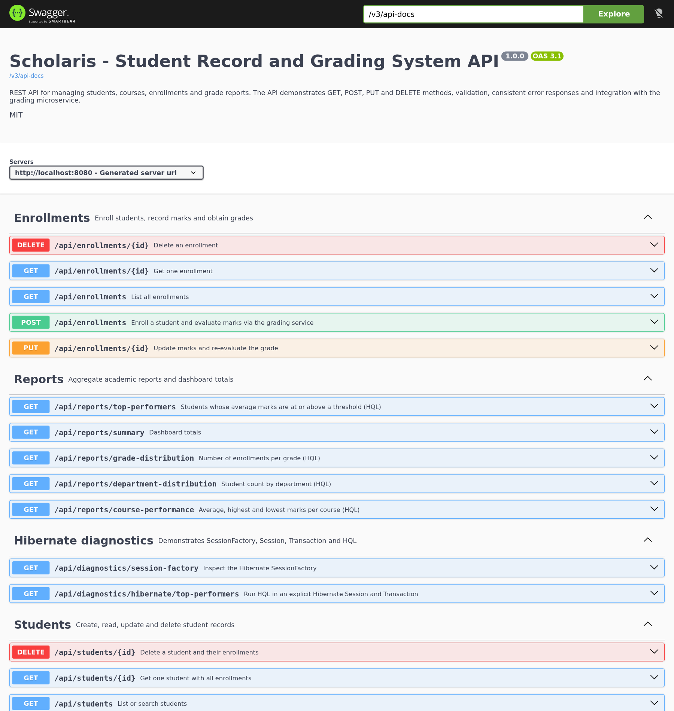

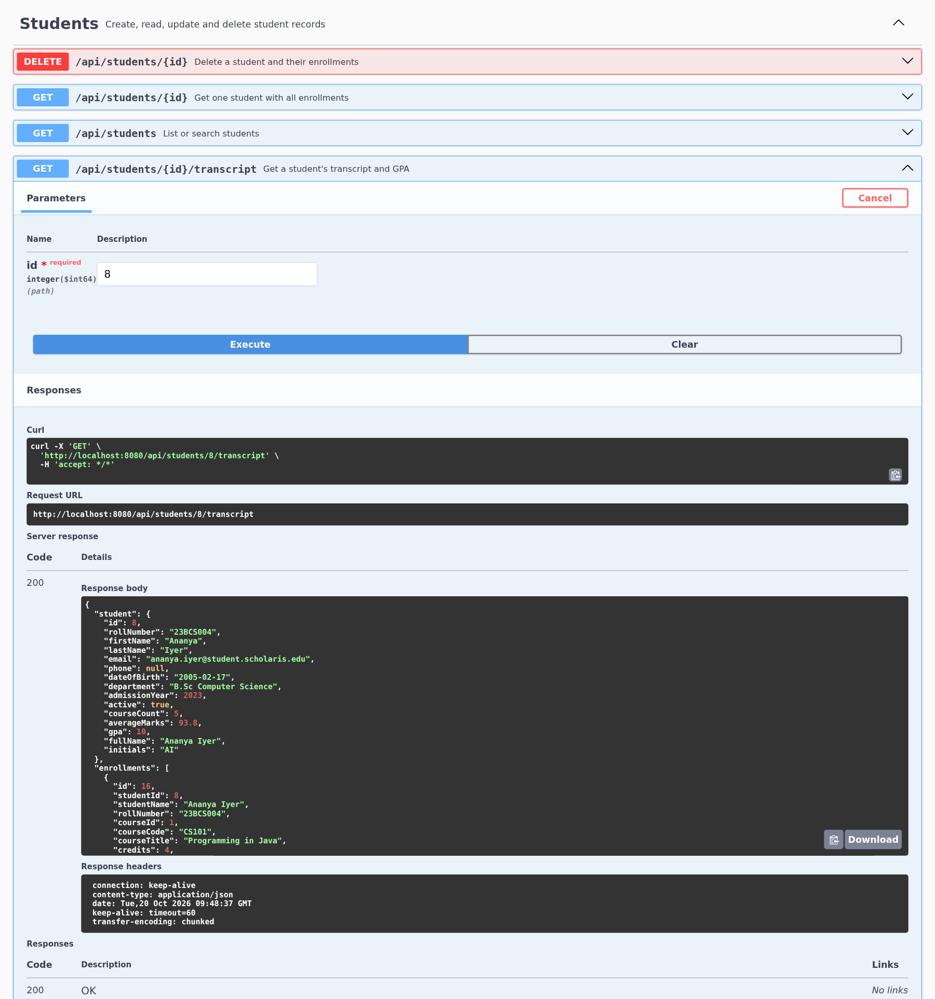

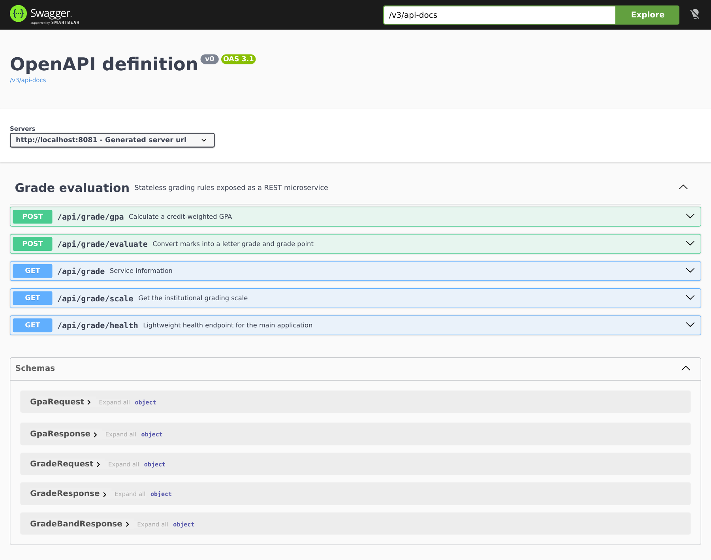

The complete transcript with status codes and JSON bodies is in `docs/api-test-output.txt`. The Postman collection and environment are in `postman/`. The screenshots are captured from the running application, not mocked.

## 9.5 Error contract and status codes

| Status | When it is returned | Example |
| --- | --- | --- |
| 200 | Successful GET or PUT | Student detail, transcript, report, mark update |
| 201 | Successful POST | New student, course or enrollment |
| 204 | Successful DELETE | Enrollment removed |
| 400 | Validation failure, malformed JSON, invalid path variable | Empty student body, marks = 150 |
| 404 | Entity does not exist | `/api/students/999999` |
| 409 | Duplicate email, roll number, course code or enrollment | Existing student email |
| 500 | Unexpected server error | Internal failure; details logged, generic message returned |

The same contract is used by both the main API and, with minor wording differences, the grading service. This makes client error handling predictable.

## 9.6 What the tests demonstrate

The API tests demonstrate that:

- GET and POST work, and PUT and DELETE are also implemented;
- resources have stable URIs and meaningful status codes;
- validation is enforced on the server, not only in the browser;
- duplicates are rejected consistently;
- the transcript aggregates enrollment data correctly;
- the grading service is actually called and its result is persisted;
- the HQL reports return the expected aggregate shapes;
- the diagnostics endpoints expose the Hibernate `SessionFactory` and an explicit transaction;
- temporary test data can be cleaned up, leaving the seeded database unchanged.

# 10. Web Services: REST and SOAP {#web-services}

## 10.1 What is a web service?

A **web service** is a software interface exposed over a network that allows one application to interact with another using standard protocols and a machine-readable description. The client does not need to know the server's implementation language or internal database; it only needs to know the contract: the address, the operations, the message format and the error behaviour.

Web services are the foundation of service-oriented integration. A student record system might expose a service so that a mobile app, a reporting dashboard or an examination system can read and write records without direct database access. The service boundary also allows the provider to change its internal implementation as long as the contract remains stable.

## 10.2 REST

**REST** (Representational State Transfer) is an architectural style, not a protocol. A REST API models the system as **resources**, each identified by a URI, and uses standard HTTP methods to act on them. The server transfers a representation of the resource, commonly JSON.

Key characteristics:

- **Resources and URIs.** `/api/students` is a collection; `/api/students/8` is a specific student.
- **HTTP methods.** GET retrieves, POST creates, PUT replaces or updates, DELETE removes. HEAD and PATCH are also common.
- **Statelessness.** Each request contains all the information needed to process it. The server does not rely on a stored client session for API calls.
- **Uniform interface.** The same method has the same meaning for every resource.
- **Representations.** JSON is used here; XML, CSV or HTML are also possible.
- **Cacheability.** GET responses can be cached if headers allow it. This project does not set explicit cache headers because the data changes frequently.
- **Layered system.** A client can talk to a gateway, load balancer or proxy without knowing the final server.
- **Status codes.** The response status communicates the outcome: 200, 201, 204, 400, 404, 409, 500.

### 10.2.1 REST in this project

The main application exposes 23 endpoints across students, courses, enrollments, reports and diagnostics. The grading service exposes 5 endpoints. The API uses:

- nouns in URIs (`/students`, `/courses`), not verbs;
- HTTP methods for actions;
- JSON request and response bodies;
- `Location` headers on 201 responses;
- 204 for successful deletes;
- a consistent error body;
- OpenAPI for a machine-readable contract.

The project does not implement HATEOAS links, API versioning or OAuth 2.0. Those are deliberate scope choices, not claims that the API is fully mature. The core REST constraints (resources, HTTP methods, stateless requests, uniform interface) are satisfied.

## 10.3 SOAP

**SOAP** (Simple Object Access Protocol) is a protocol for exchanging structured messages, usually over HTTP but also over SMTP or other transports. A SOAP message is an XML document with:

- an **Envelope** that defines the message structure;
- a **Header** for metadata such as security or routing;
- a **Body** containing the operation request or response;
- an optional **Fault** element for errors.

SOAP services are described by a **WSDL** (Web Services Description Language) document, which specifies the operations, messages, bindings and endpoint. Historically, UDDI was used as a directory of services. SOAP has a rich set of WS-* standards for security, transactions, reliable messaging and attachments.

A SOAP request has a much larger envelope than an equivalent JSON payload. For example, a marks evaluation might look like:

```xml
<soap:Envelope xmlns:soap="http://schemas.xmlsoap.org/soap/envelope/">
  <soap:Body>
    <EvaluateMarks xmlns="http://example.edu/grading">
      <marks>92</marks>
    </EvaluateMarks>
  </soap:Body>
</soap:Envelope>
```

The response would be another XML envelope. The WSDL would define the `EvaluateMarks` operation and its types.

## 10.4 REST versus SOAP

| Dimension | REST | SOAP |
| --- | --- | --- |
| Nature | Architectural style | Protocol with a formal XML message format |
| Transport | Usually HTTP; can use any HTTP method | Usually HTTP POST; can use other transports |
| Message format | JSON, XML, HTML, plain text; JSON is common | XML only, wrapped in an Envelope |
| Contract | OpenAPI/Swagger, informal documentation or hypermedia | WSDL + XSD, formally machine-readable |
| Operations | Resources and HTTP verbs | Named operations exposed as methods |
| State | Stateless by design | Can be stateless or stateful (WS-* supports sessions) |
| Performance | Lightweight payloads, good for web/mobile | Larger XML payloads and parsing overhead |
| Caching | HTTP caching works naturally | Difficult because most calls are POST |
| Error handling | HTTP status codes + error body | SOAP Fault element |
| Security | HTTPS, OAuth 2.0, JWT, API keys | WS-Security, SAML, XML Encryption/Signature |
| Transactions | Application-level; distributed transactions are hard | WS-AtomicTransaction and related standards |
| Tooling | Simple clients, curl, Postman, browsers | Strong typing and generated clients from WSDL |
| Typical use | Web/mobile APIs, microservices, public APIs | Enterprise integrations, banking, legacy systems, formal contracts |

### 10.4.1 Why REST was chosen here

- The application is a web/mobile-friendly CRUD system; resources map naturally to students, courses and enrollments.
- JSON is compact and easy to inspect in Swagger, Postman and curl.
- Spring MVC and `RestClient` support REST directly with minimal configuration.
- The grading service is a simple function; a full SOAP stack and WSDL would add unnecessary complexity.
- The assignment explicitly asks for GET and POST, which map directly to REST.
- The same API can later be consumed by a JavaScript front end or a mobile app.

SOAP would be a better choice if the institution already had a WS-* security infrastructure, required formal WSDL contracts across many legacy systems, or needed WS-AtomicTransaction across heterogeneous platforms. Those requirements are outside this project's scope.

## 10.5 JSON and HTTP semantics

A REST API's behaviour is carried as much by HTTP semantics as by the URL. The project follows these conventions:

- **GET is safe and idempotent.** It does not change server state.
- **PUT is idempotent.** Sending the same update twice has the same effect as sending it once.
- **DELETE is idempotent in effect.** The first call returns 204; a repeated call returns 404, but the resource remains deleted.
- **POST is not idempotent.** Creating the same student twice would produce two records if the unique constraints did not reject it; the service returns 409 instead.
- **Content-Type** is `application/json` for requests and responses.
- **Accept** can be used to request JSON; Spring's content negotiation handles it.
- **Location** on 201 points to the new resource.
- **Timestamps** are ISO-8601 UTC instants.

These conventions make the API predictable for clients and testable with generic HTTP tools.

# 11. Microservices and Spring Cloud {#microservices}

## 11.1 Monolithic architecture

A **monolith** is an application deployed as a single unit. In this project, the `student-record-system` is a modular monolith: it has separate packages and layers, but one process, one JAR and one database. All student, course, enrollment and report operations run in the same JVM.

**Advantages of a monolith:**

- simple to develop, build, test and deploy;
- one transaction can cover multiple related changes;
- no network latency between internal calls;
- easier debugging and logging;
- no distributed data consistency problems;
- appropriate for a small team and a small domain.

**Disadvantages:**

- the whole application must be redeployed for any change;
- scaling means scaling the entire application, even if only one feature is busy;
- a failure in one module can affect the whole process;
- technology choices are shared across the codebase;
- large codebases can become tightly coupled without discipline.

The project mitigates the coupling risk with clear packages, DTO boundaries and service interfaces, but it does not claim that a monolith is always wrong. For a one-week student project, it is the right default.

## 11.2 Microservice architecture

A **microservice architecture** decomposes an application into small, independently deployable services, each owning a business capability and communicating over a network (often HTTP/REST or messaging). Each service can have its own database, release cycle and scaling policy.

**Advantages:**

- independent deployment and scaling;
- failure isolation (with circuit breakers and timeouts);
- technology heterogeneity;
- smaller, focused codebases;
- teams can own services end to end.

**Disadvantages:**

- network latency and partial failure;
- distributed transactions and eventual consistency;
- more complex testing, deployment and monitoring;
- service discovery, configuration and API versioning;
- operational overhead that can outweigh the benefits for a small system.

## 11.3 Monolith versus microservices

| Dimension | Monolith | Microservices |
| --- | --- | --- |
| Deployment | One artifact | Many independently deployed artifacts |
| Scaling | Scale the whole application | Scale individual services |
| Data | Usually one database | Database per service (or shared with strong coupling) |
| Transactions | Local ACID transactions | Distributed consistency, sagas, eventual consistency |
| Communication | In-process method calls | Network calls (REST, gRPC, messaging) |
| Failure | One process failure affects all | Partial failure; requires timeouts, retries, circuit breakers |
| Complexity | Lower operational complexity | Higher operational and cognitive complexity |
| Team fit | Small co-located team | Multiple autonomous teams |
| Technology | Shared stack | Can vary per service |
| Debugging | Single log/process | Distributed tracing and correlation IDs |
| Best for | Small domains, early products, teaching projects | Large domains with clear boundaries and mature operations |

## 11.4 The hybrid used in this project

The system is deliberately a **modular monolith plus one microservice**:

- The persistent academic core (students, courses, enrollments, reports) stays in one application. These entities are tightly coupled and benefit from local transactions.
- Grade evaluation is extracted into `grading-service`. It is stateless, has no database, and has a narrow contract: marks in, grade out.
- The main application calls the service synchronously with `RestClient`.
- If the service is unavailable, the main application falls back to a local implementation and records the source.
- The two services run on different ports and are packaged as separate JARs and Docker images.

This is a realistic first step: the boundary is chosen because grading is a self-contained policy, not because microservices are fashionable. A production evolution might extract reporting or notifications next, but only if scaling or team ownership justified it.

### 11.4.1 Interaction contract

```text
Browser/API client
       |
       v
student-record-system :8080
       |  POST /api/grade/evaluate  {"marks": 88}
       v
grading-service :8081
       |  200 {"grade":"A","gradePoint":9.0,...}
       v
student-record-system persists enrollment with graded_by = "grading-service"
```

If the call times out or fails:

```text
student-record-system -> grading-service   (connection refused / timeout)
student-record-system -> LocalGradeCalculator
student-record-system persists enrollment with graded_by = "local-fallback"
```

The fallback is not silent: it is logged and stored, so the data remains explainable.

### 11.4.2 Data ownership

The grading service owns the grade scale. The main application owns the student, course and enrollment records. The main application stores a copy of the awarded grade and grade point because they are part of the academic record and are needed for reports. This is a deliberate denormalisation: the grade is a historical result, not a live view of the current scale. If the scale changes later, previously awarded grades should not silently change.

## 11.5 Spring Cloud

**Spring Cloud** is a collection of projects that provides patterns and tools for building distributed systems with Spring Boot. It is not required to call a REST service; `RestClient`, `WebClient` or `RestTemplate` can do that. Spring Cloud adds the operational plumbing that becomes necessary when there are many services.

Relevant Spring Cloud features:

| Feature | Project | Purpose |
| --- | --- | --- |
| Service discovery | Netflix Eureka, Consul, Zookeeper | Services register themselves and find each other by name instead of hard-coded hosts |
| API gateway | Spring Cloud Gateway | Single entry point, routing, filters, rate limiting, authentication |
| Central configuration | Spring Cloud Config | Externalised configuration per service and environment, with refresh |
| Client-side load balancing | Spring Cloud LoadBalancer | Distribute calls across service instances |
| Circuit breaking / resilience | Resilience4j, Spring Cloud Circuit Breaker | Timeouts, retries, bulkheads, fallback and failure metrics |
| Distributed tracing | Micrometer Tracing, Zipkin, OpenTelemetry | Follow a request across service boundaries |
| Messaging | Spring Cloud Stream | Bind services to Kafka, RabbitMQ or other brokers |
| Contract testing | Spring Cloud Contract | Verify producer/consumer contracts |
| Security | Spring Cloud Security | Token propagation and OAuth 2.0 integration |

### 11.5.1 What this project uses and what it would add

This project uses only the core Spring Boot HTTP client and a fixed base URL. That is appropriate for two services on one machine and keeps the demonstration understandable. In a larger deployment, the following additions would be natural:

1. **Eureka** or Consul so the main application can call `http://grading-service` by service ID rather than a fixed host.
2. **Spring Cloud Gateway** as the single entry point for clients, with routing and rate limiting.
3. **Spring Cloud Config** to manage the grading URL, timeouts and feature flags per environment.
4. **Resilience4j** for a real circuit breaker, retry policy, bulkhead and metrics instead of the hand-written fallback.
5. **Micrometer Tracing + Zipkin/OpenTelemetry** to trace a request from the browser through the main service to the grading service.
6. **Spring Cloud Contract** to verify that the grading service's response shape remains compatible with the main application's client.

The purpose of Spring Cloud is therefore not "to make services micro"; it is to solve the operational problems that appear once a system is distributed: discovery, configuration, routing, resilience, observability and contract management.

# 12. DevOps Practices {#devops}

## 12.1 What is DevOps?

**DevOps** is a set of cultural and technical practices that bring development and operations together to deliver software faster, more reliably and with fewer hand-offs. It emphasises:

- **Culture:** shared ownership, blameless retrospectives, collaboration between developers and operators.
- **Automation:** build, test, package, deploy and infrastructure changes are automated.
- **Measurement:** metrics, logs, traces and feedback loops.
- **Sharing:** documentation, reusable tooling and knowledge.

DevOps is not a single tool. Git, Maven, JUnit, GitHub Actions, Docker and Actuator are tools that support the practices; the practices themselves are about reducing batch size, catching problems early and making releases routine.

## 12.2 Benefits

| Benefit | How it appears in this project |
| --- | --- |
| **Faster feedback** | `./mvnw verify` runs 52 tests in the build; CI runs the same command on every push |
| **Repeatable builds** | Maven Wrapper pins Maven 3.9.9; the parent POM pins Spring Boot 3.5.16 |
| **Fewer environment problems** | H2 removes the need for a local database; Docker Compose runs both services with one command |
| **Smaller, safer changes** | Git commits and pull requests; CI catches regressions before merge |
| **Operational visibility** | Actuator health, grading-service health card, structured logs and AOP timing |
| **Faster recovery** | Health checks and `restart: unless-stopped` in Compose; data persisted in a named volume |
| **Documentation as code** | README, OpenAPI, schema scripts and Postman collection live with the source |

## 12.3 Tools used

| Tool | Role in the project |
| --- | --- |
| **Git** | Local version control; commits capture the evolution of the project |
| **GitHub** | Remote repository, collaboration and CI trigger |
| **Maven** | Dependency management, compilation, testing and packaging |
| **Maven Wrapper** | Reproducible Maven version without a system install |
| **JUnit 5 / AssertJ / Mockito** | Automated unit and integration tests |
| **Spring Boot Test / MockMvc** | Web layer and REST contract tests |
| **GitHub Actions** | CI workflow: build, test, upload JARs, build Docker images |
| **Docker** | Multi-stage image builds for both modules |
| **Docker Compose** | Runs both services, network, health checks and persistent volume |
| **H2 console** | Database inspection during development |
| **Springdoc / Swagger UI** | Living API documentation |
| **Actuator** | Health endpoint for local checks and container health |
| **Postman / Newman** | API collection and command-line regression run |

## 12.4 Git and GitHub workflow

The repository is <https://github.com/Senthil455/Student-Record-Grading-System>. A typical workflow is:

```bash
git status
git add .
git commit -m "Add student CRUD, HQL reports and grading microservice"
git push origin main
```

For team development, the recommended workflow is:

1. Create a feature branch: `git switch -c feature/report-export`.
2. Make small commits with descriptive messages.
3. Push the branch and open a pull request.
4. Let GitHub Actions run the build and tests.
5. Review the diff, squash or merge, and delete the branch.

The repository includes a `.gitignore` for build output, IDE files, runtime H2 data and logs. Generated JARs, `target/` directories and `data/` are not committed; source, tests, schema and documentation are.

## 12.5 Maven build lifecycle

| Phase | What it does in this project |
| --- | --- |
| `validate` | Checks the project structure |
| `compile` | Compiles main sources for both modules |
| `test` | Runs 52 tests with the test profile |
| `package` | Creates executable JARs with the Spring Boot repackage plugin |
| `verify` | Runs any verification after packaging; the CI entry point |
| `install` | Copies artifacts to the local Maven repository (optional) |
| `deploy` | Publishes to a remote repository (not used) |

Useful commands:

```bash
./mvnw clean verify                 # full build and tests
./mvnw test                         # tests only
./mvnw -pl grading-service test     # one module
./mvnw -pl student-record-system spring-boot:run
./mvnw -pl grading-service spring-boot:run
```

The multi-module reactor builds `grading-service` first because the parent lists it first and the main module does not depend on it at compile time. Both modules inherit dependency and plugin management from the parent.

## 12.6 Continuous integration

`.github/workflows/ci.yml` defines two jobs:

1. **verify** on JDK 17:
   - checkout;
   - set up Temurin JDK 17 with Maven cache;
   - run `./mvnw -B clean verify`;
   - upload both executable JARs as artifacts.
2. **docker** (after verify):
   - build the main application image with `--build-arg MODULE=student-record-system`;
   - build the grading service image with `--build-arg MODULE=grading-service`.

The workflow runs on pushes to `main`, pull requests to `main` and manual dispatch. It uses `permissions: contents: read`, following the principle of least privilege. The CI does not deploy to a cloud environment; that would require registry credentials and an environment-specific deployment step. The build and image creation are the reproducible part that matters for this assignment.

## 12.7 Docker and Docker Compose

The `Dockerfile` is a multi-stage build:

- **Build stage:** `maven:3.9.9-eclipse-temurin-17`, copy the POMs first to cache dependency resolution, then copy sources and package the requested module.
- **Runtime stage:** `eclipse-temurin:17-jre-jammy`, install `curl` for health checks, copy the JAR, expose 8080/8081 and run `java -jar`.
- A build argument `MODULE` selects which module to package, so one Dockerfile serves both services.

`docker-compose.yml` defines:

- `grading-service` on 8081 with a health check;
- `student-record-system` on 8080, depending on the grading service being healthy;
- `GRADING_SERVICE_BASE_URL=http://grading-service:8081` so the main service uses Docker's DNS;
- a named volume `scholaris-student-data` mounted at `/app/data` for H2 persistence;
- `restart: unless-stopped` and health checks for both services.

Start everything with:

```bash
docker compose up --build
```

Stop with `Ctrl+C`, or run `docker compose down`. Add `-v` only if the data volume should be deleted.

## 12.8 Environment parity and configuration

The same application runs in three ways:

| Environment | Database | Grading URL | How it starts |
| --- | --- | --- | --- |
| Local H2 | H2 file in `./data` | `http://localhost:8081` | `./mvnw spring-boot:run` or JAR |
| Local MySQL | MySQL `student_grading` | `http://localhost:8081` | `SPRING_PROFILES_ACTIVE=mysql` |
| Docker Compose | H2 file in the volume | `http://grading-service:8081` | `docker compose up --build` |

Configuration is externalised through properties and environment variables (`SERVER_PORT`, `SPRING_DATASOURCE_URL`, `GRADING_SERVICE_BASE_URL`, `APP_SEED_ENABLED`). This is a small-scale version of the twelve-factor configuration principle: the artifact is built once and configured per environment.

## 12.9 DevOps limitations and next steps

The project does not include:

- a container registry push (GitHub Container Registry or Docker Hub);
- automated deployment to a cloud environment;
- infrastructure as code (Terraform or Kubernetes manifests);
- database migrations with Flyway or Liquibase;
- centralized logging, metrics dashboards or alerting;
- secrets management (the MySQL password is a local default).

These would be the next DevOps improvements. For a one-week mini-project, the important achievement is that a clean clone can be built, tested, packaged and run with the same commands on a developer machine and in CI.

# 13. Testing and Quality Assurance {#testing}

## 13.1 Test strategy

The test suite follows a practical version of the test pyramid:

- **Unit tests** for pure logic (grade boundaries, GPA, local fallback).
- **Repository tests** for HQL, entity mapping and inheritance (`@DataJpaTest`).
- **Web MVC tests** for Thymeleaf rendering, form validation and 404 handling (`@SpringBootTest` + MockMvc).
- **REST integration tests** for the full HTTP contract, validation, conflicts and the fallback path.
- **Manual/API tests** with Swagger, Postman/Newman and curl for the running application.

The test profile (`src/test/resources/application-test.properties`) uses an in-memory H2 database with `create-drop`, disables data seeding, disables the remote grading service and points it at an unused port. This makes tests fast, isolated and deterministic. Disabling the remote service also ensures the fallback path is exercised in `RestApiIntegrationTest`.

## 13.2 Test classes and counts

| Module | Test class | Tests | Focus |
| --- | --- | ---: | --- |
| grading-service | `GradeCalculatorTest` | 18 | Boundary values, invalid marks, GPA, scale ordering |
| grading-service | `GradeControllerTest` | 5 | REST contract, validation, health, GPA |
| student-record-system | `LocalGradeCalculatorTest` | 15 | Fallback boundaries, invalid input, source label |
| student-record-system | `RepositoryHqlTest` | 5 | HQL aggregates, subquery, JOINED inheritance |
| student-record-system | `MvcControllerIntegrationTest` | 4 | Dashboard, list/profile, form validation, 404 |
| student-record-system | `RestApiIntegrationTest` | 5 | Full CRUD workflow, transcript, validation, conflicts, diagnostics |
| **Total** | **6 classes** | **52** | |

The actual Surefire results are:

```text
grading-service
  GradeCalculatorTest        Tests run: 18, Failures: 0, Errors: 0, Skipped: 0
  GradeControllerTest        Tests run:  5, Failures: 0, Errors: 0, Skipped: 0

student-record-system
  LocalGradeCalculatorTest   Tests run: 15, Failures: 0, Errors: 0, Skipped: 0
  RepositoryHqlTest          Tests run:  5, Failures: 0, Errors: 0, Skipped: 0
  MvcControllerIntegrationTest Tests run: 4, Failures: 0, Errors: 0, Skipped: 0
  RestApiIntegrationTest     Tests run:  5, Failures: 0, Errors: 0, Skipped: 0

Total: 52 tests, 0 failures, 0 errors, 0 skipped
```

## 13.3 What each test proves

### 13.3.1 GradeCalculatorTest

- Each grade boundary maps to the correct letter and grade point.
- Marks below 0 and above 100 are rejected.
- GPA is credit-weighted, not a simple average.
- Mismatched GPA input lists are rejected.
- The scale exposes exactly seven ordered bands from A+ to F.

### 13.3.2 GradeControllerTest

- `POST /api/grade/evaluate` returns 200 with the expected grade, point, pass flag and `evaluatedBy`.
- Invalid marks return 400 with a field error.
- `GET /api/grade/scale` returns seven bands.
- `POST /api/grade/gpa` returns the expected weighted GPA and total credits.
- `GET /api/grade/health` returns `UP`.

### 13.3.3 LocalGradeCalculatorTest

- The fallback applies exactly the same boundaries as the remote service.
- Invalid marks are rejected.
- The source is always `local-fallback`, which makes the fallback visible in the enrollment record.

### 13.3.4 RepositoryHqlTest

- Top-performer HQL applies grouping, `HAVING` and ordering correctly.
- Course statistics aggregate average, highest, lowest and count.
- The subquery finds students without enrollments.
- Department grouping returns the expected counts.
- The JOINED mapping stores 3 students and 1 instructor as 4 person rows, 3 student rows and 1 instructor row, and a polymorphic `Person` query returns all 4. This directly verifies the inheritance strategy at the database level.

### 13.3.5 MvcControllerIntegrationTest

- The dashboard renders with the Scholaris branding and tagline.
- A created student appears in the list and profile pages.
- An empty student form redisplays with validation messages.
- A missing student returns the 404 view with HTTP 404.

### 13.3.6 RestApiIntegrationTest

- The full workflow creates a student, creates a course, enrolls with marks 87.5 (fallback grade A), updates to 92 (A+), reads the transcript, checks the report summary and deletes the enrollment.
- An empty student payload returns 400 with field errors.
- Duplicate email and roll number return 409.
- An unknown student returns 404.
- The diagnostics endpoints return an open SessionFactory with 5 entities and execute explicit HQL.

The test also verifies the `Location` header on creation and the `gradedBy = local-fallback` value, proving that the fallback path is wired correctly.

## 13.4 Manual testing evidence

| Evidence | Location |
| --- | --- |
| Real curl transcript with headers, status codes and bodies | `docs/api-test-output.txt` |
| Postman collection and environment | `postman/` |
| Newman summary (34 requests, 59 assertions, 0 failures) | `docs/api-test-output.txt` |
| Swagger UI screenshots | `docs/screenshots/swagger-*.png` |
| UI page screenshots | `docs/screenshots/*.png` |
| H2 console screenshots | `docs/screenshots/h2-*.png` |
| Automated build output | `./mvnw clean verify`; Surefire reports in `target/surefire-reports/` |

## 13.5 Test limitations

- The tests use H2, not MySQL. The MySQL profile is manually verified but not part of CI.
- There is no browser automation test for every page; the UI is checked with MockMvc and screenshots.
- There is no load or performance test. The dataset is small and the application is a teaching project.
- There is no contract test between the two services beyond the integration test and Postman assertions. Spring Cloud Contract would be the next step.
- Concurrent duplicate enrollment is protected by the unique constraint, but there is no dedicated concurrency test.

These limitations are documented rather than hidden, and each has a clear future improvement.
# 14. Results and Demonstration {#results}

## 14.1 Working application

The application was built, started and exercised on the development machine. The seeded database contains 9 students, 4 instructors, 6 courses and 40 enrollments. The grading service is online, and the dashboard reports the service status in real time.

### 14.1.1 Dashboard

<figure>
  
  <figcaption>Figure 14.1 &mdash; Dashboard with totals, top performers, course averages, recent enrollments and grading-service status.</figcaption>
</figure>

The dashboard is the entry point for the demonstration. It shows:

- 9 students and 9 active students;
- 6 courses;
- 40 enrollments, all graded;
- an overall average of 78.70%;
- the top five performers (Ananya Iyer first at 93.80%);
- the best-performing courses;
- recent enrollment activity with grade chips;
- a department distribution and a grading-service health card.

The page is assembled from the same services that power the API, so it is a useful visual check that the database, HQL queries and grading integration are all working.

### 14.1.2 Student register and search

<figure>
  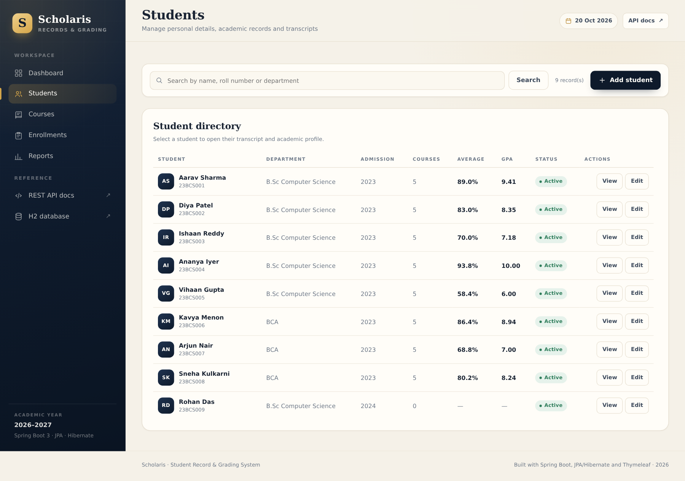
  <figcaption>Figure 14.2 &mdash; Searchable student register with roll number, department, course count, average and GPA.</figcaption>
</figure>

The register supports case-insensitive search across first name, last name, roll number and department. Each row links to the student's profile and edit form. The empty-state message is shown when a search has no matches.

### 14.1.3 Student profile and transcript

<figure>
  
  <figcaption>Figure 14.3 &mdash; Student profile with academic summary, transcript lines, grades and GPA.</figcaption>
</figure>

The profile combines personal details, an academic summary (courses, credits, graded courses, passed courses, GPA) and a transcript ordered by course code. Each line shows marks, grade, grade point, semester and grading source. The action buttons link to edit, enroll and delete.

### 14.1.4 Form validation

<figure>
  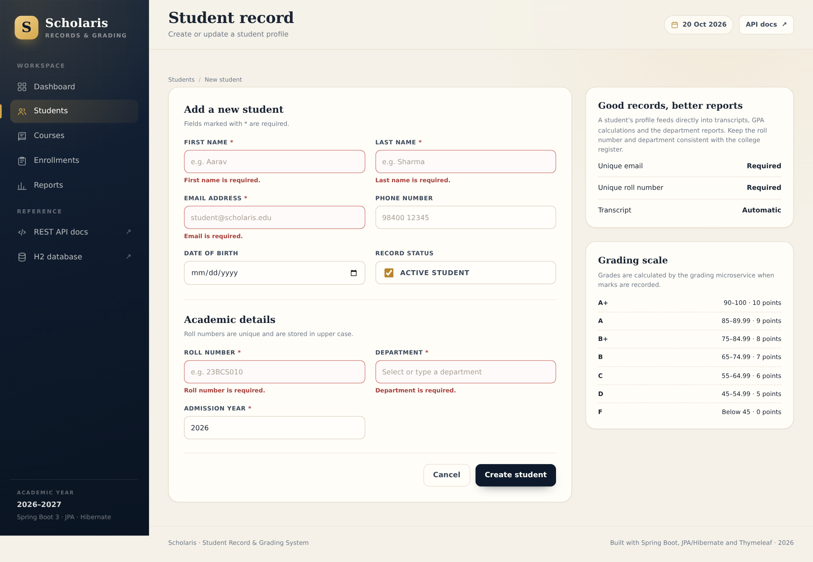
  <figcaption>Figure 14.4 &mdash; Server-side validation messages on the student form.</figcaption>
</figure>

The form uses Bean Validation and `BindingResult`. Required fields, email format, admission year range and date-of-birth rules are enforced on the server. The form retains the user's input and displays the messages inline; it does not rely on browser-only validation.

### 14.1.5 Course catalogue and roster

<figure>
  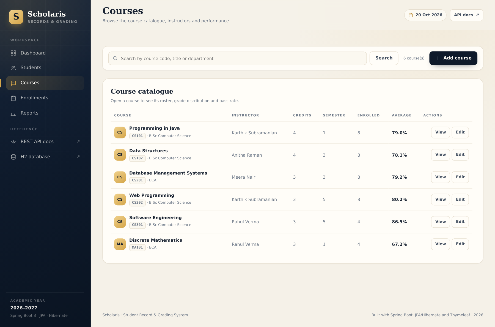
  <figcaption>Figure 14.5 &mdash; Course catalogue with code, title, credits, instructor, enrollment count and average.</figcaption>
</figure>

<figure>
  
  <figcaption>Figure 14.6 &mdash; Course detail with instructor, roster, grade distribution and pass rate.</figcaption>
</figure>

The course detail page demonstrates the other side of the many-to-many relationship: it lists every enrolled student, their marks and grade, and summarises the grade distribution and pass rate. The roster is ordered by roll number, not by enrollment ID, so it is easy to read.

### 14.1.6 Enrollment workflow

<figure>
  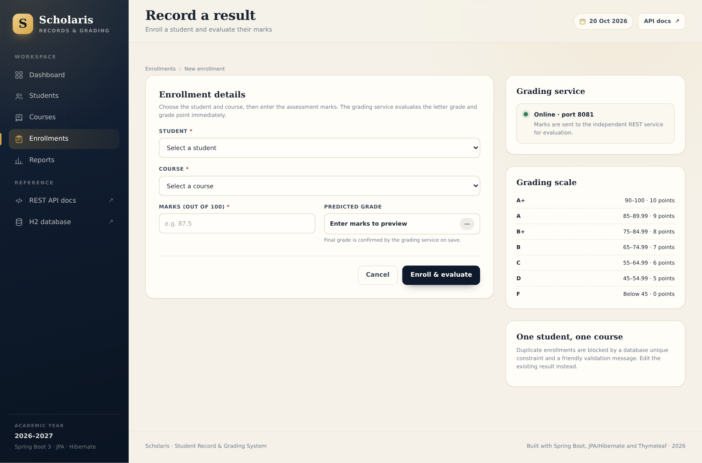
  <figcaption>Figure 14.7 &mdash; Enrollment form: choose a student and course and enter marks.</figcaption>
</figure>

<figure>
  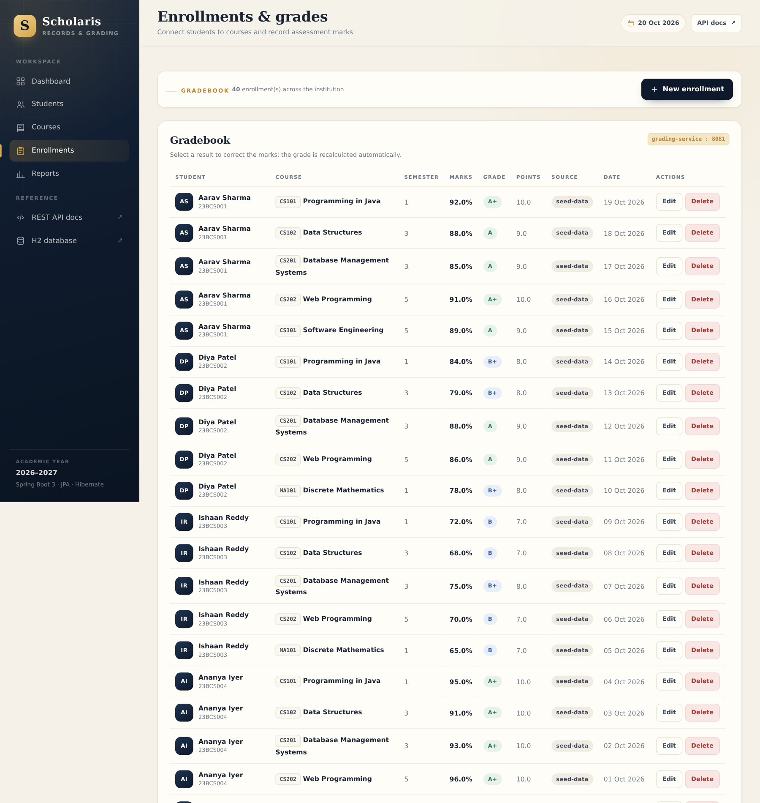
  <figcaption>Figure 14.8 &mdash; Enrollment list with student, course, marks, grade, grading source and actions.</figcaption>
</figure>

When the form is submitted, the main application calls the grading service, receives the grade and grade point, and stores them with the enrollment. The list shows whether the result came from `grading-service`, `local-fallback` or `seed-data`. The edit page allows marks to be corrected; the grade is recalculated and the new value is visible immediately.

### 14.1.7 Reports and HQL demonstration

<figure>
  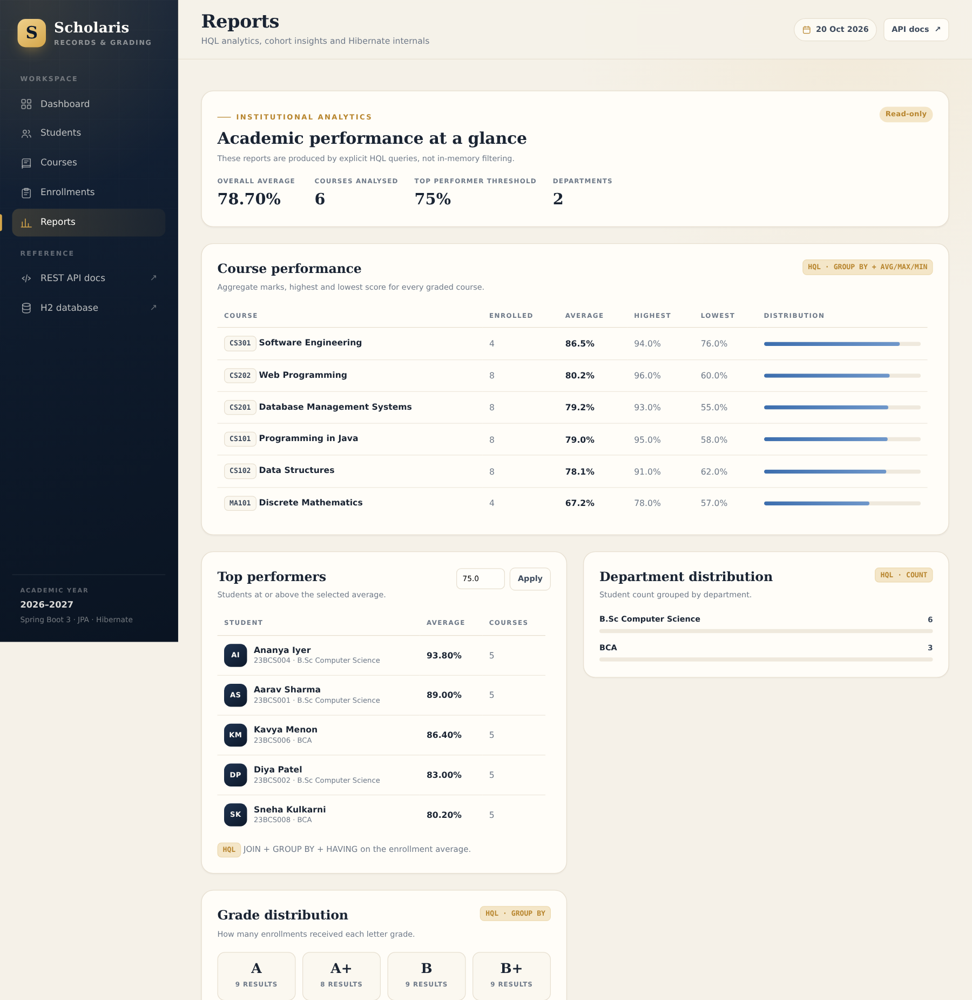
  <figcaption>Figure 14.9 &mdash; Reports: top performers, course performance and department distribution.</figcaption>
</figure>

<figure>
  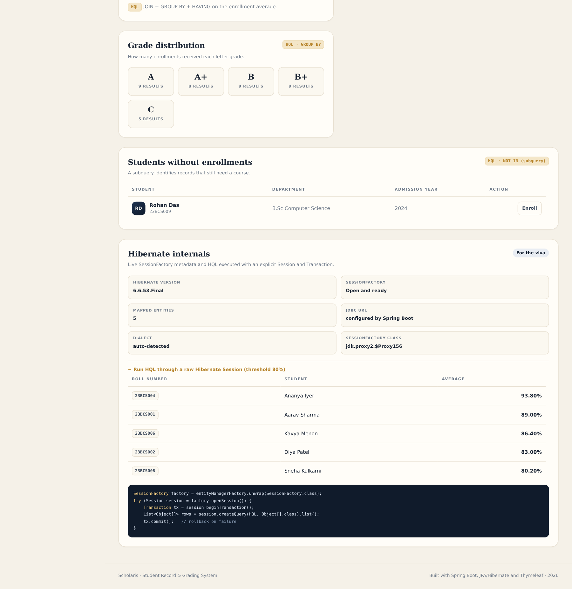
  <figcaption>Figure 14.10 &mdash; Reports: grade distribution, students without enrollments, SessionFactory metadata and explicit HQL results.</figcaption>
</figure>

The reports page is the clearest demonstration of the HQL requirement. It shows the output of five aggregate queries and a separate panel with:

- the Hibernate version and SessionFactory class;
- whether the SessionFactory is open;
- the five mapped entity names;
- the result of a query executed through an explicit `Session` and `Transaction`.

The threshold for top performers is configurable through the `minAverage` request parameter, so the page can demonstrate different result sets without code changes.

### 14.1.8 Error handling

<figure>
  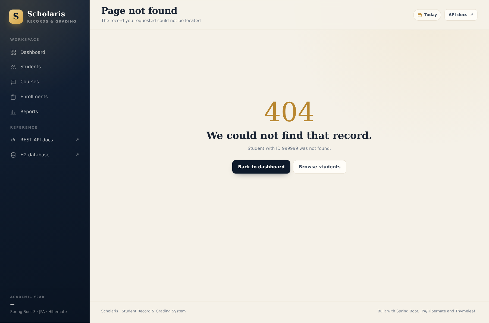
  <figcaption>Figure 14.11 &mdash; Friendly 404 page for a missing student.</figcaption>
</figure>

The 404 page is rendered by `WebExceptionHandler` for the MVC routes. The REST API returns a JSON 404 with the same information. This distinction &mdash; HTML for people, JSON for programs &mdash; is an important part of the design.

### 14.1.9 Database inspection

<figure>
  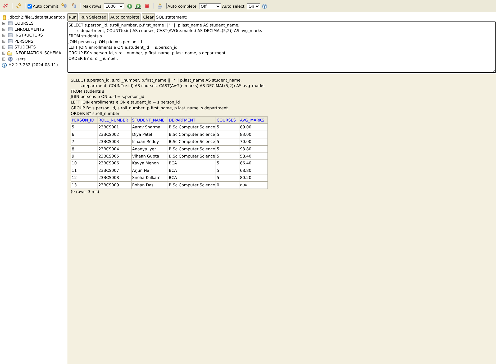
  <figcaption>Figure 14.12 &mdash; H2 console showing the JOINED schema and a live query.</figcaption>
</figure>

The H2 console is enabled for local development. It allows the demonstrator to inspect the five tables, verify the shared `persons` keys, run a `SELECT` and show the physical result of the JOINED mapping. The console is disabled in the test profile and should be disabled or protected in production.

### 14.1.10 REST API documentation and testing

<figure>
  
  <figcaption>Figure 14.13 &mdash; Swagger UI for the main application: students, courses, enrollments, reports and diagnostics.</figcaption>
</figure>

<figure>
  
  <figcaption>Figure 14.14 &mdash; Executing a request in Swagger UI and inspecting the response.</figcaption>
</figure>

<figure>
  
  <figcaption>Figure 14.15 &mdash; Swagger UI for the grading microservice on port 8081.</figcaption>
</figure>

Swagger UI provides a discoverable, executable contract. The screenshots show the endpoint groups, the request body editor and a real response. The same endpoints are exercised by the Postman collection and the automated tests.

## 14.2 Results against objectives

| Objective | Result | Evidence |
| --- | --- | --- |
| O1 &mdash; Spring Boot MVC with layering | Achieved | MVC pages, controller/service/repository packages, screenshots |
| O2 &mdash; JPA/Hibernate CRUD | Achieved | Student, course and enrollment CRUD in UI and API |
| O3 &mdash; ORM mapping and ID strategy | Achieved | `@OneToMany`, `@ManyToOne`, `@JoinColumn`, cascade, `IDENTITY` |
| O4 &mdash; At least two HQL queries | Achieved (five plus one) | Reports page, `/api/reports/*`, `HibernateDemoService` |
| O5 &mdash; Inheritance mapping | Achieved | `Person` &rarr; `Student`/`Instructor`, `JOINED`, repository test |
| O6 &mdash; SessionFactory/Session/Transaction | Achieved | `HibernateDemoService`, diagnostics endpoints, reports page |
| O7 &mdash; DI and ApplicationContext | Achieved | Constructor injection, `@Bean RestClient`, Spring Boot context |
| O8 &mdash; AOP logging | Achieved | `LoggingAspect`, service entry/exit/timing logs |
| O9 &mdash; REST API with GET/POST and tests | Achieved | 23 main endpoints, 5 grading endpoints, Swagger, Postman, MockMvc |
| O10 &mdash; Second service and REST interaction | Achieved | `grading-service` on 8081, `RestClient`, fallback |
| O11 &mdash; DevOps | Achieved | Git/GitHub, Maven Wrapper, CI, Docker, Compose |
| O12 &mdash; Report and submission artifacts | Achieved | This report, screenshots, schema, sample data, run instructions |

## 14.3 Discussion

### 14.3.1 What worked well

- **The domain was a good fit for the syllabus.** Every requirement had a natural place in the application rather than feeling bolted on.
- **DTO mapping kept the API stable.** The entities could evolve without breaking the JSON contract, and lazy-loading problems were avoided.
- **The explicit HQL queries produced readable reports.** The top-performer query in particular demonstrates joins, grouping, `HAVING` and ordering in a way that is easy to explain.
- **The grading service boundary was clean.** Because it is stateless and has no database, it required no distributed transaction and could be tested independently.
- **The fallback made the demo robust.** Even if port 8081 was not running, mark entry still worked, and the `graded_by` column made the behaviour visible.
- **The test profile was deterministic.** In-memory H2, no seeding and a disabled remote service made tests fast and repeatable.

### 14.3.2 Challenges and how they were resolved

**Lazy loading and DTO assembly.** The first version returned entities from some service methods and occasionally hit `LazyInitializationException` when a template or controller accessed an unloaded collection after the transaction. The fix was to assemble DTOs inside the service transaction, use `@EntityGraph` for the required associations and set `open-in-view=false` so the boundary is explicit. This is both a bug fix and a better design.

**Consistency of both sides of a relationship.** When creating an enrollment, adding the new object only to the owning side could leave the in-memory student collection stale during the immediate redirect. The service now adds the enrollment to the student's collection and the course's collection, while Hibernate uses the owning `@ManyToOne` side for the actual foreign key. The repository test and REST workflow test cover this.

**Identity gaps in JOINED inheritance.** Student IDs start at 5 because the seeded instructors occupy IDs 1&ndash;4 in the shared `persons` identity column. This initially looked like a bug but is expected behaviour: both subclasses share the base table's identity. The report and the 404 demonstration use this fact deliberately.

**H2 file locking.** Running two instances of the main application against the same H2 file causes a lock error. The README explains that only one main instance should run at a time, and Docker uses a single container and a named volume. MySQL would remove this limitation.

**Responsive screenshots.** Some pages are long, especially reports and Swagger. The report uses focused crops for readability while the complete originals remain in `docs/screenshots/`.

### 14.3.3 Quality observations

- The codebase is small enough to explain but not toy-like: it has validation, error contracts, transactions, tests, documentation and deployment.
- The 52 tests cover the critical paths, including boundary values, duplicate handling, fallback behaviour, HQL and inheritance.
- The API and UI share services, so there is no duplicated business logic.
- The logs show service entry/exit and timing, which makes the AOP advice visible during a demonstration.
- The project has no compiler warnings that affect correctness and builds cleanly with `./mvnw clean verify`.

# 15. Limitations and Future Work {#future}

## 15.1 Current limitations

| Area | Limitation | Impact |
| --- | --- | --- |
| Authentication | No login, roles or permissions | Not suitable for real student data without an access-control layer |
| Instructor UI | Instructors are seeded and assigned, but have no dedicated CRUD screens | Adequate for the demo, incomplete for a real institution |
| Database | H2 file by default; MySQL profile is manual | H2 is not a multi-user production database; no migrations |
| Reporting | Reports are page-based and not exportable | No PDF/Excel export or scheduled reports |
| API | No versioning, pagination, filtering beyond `q`, or HATEOAS | Fine for a small dataset; not ready for a large public API |
| Microservices | Fixed URL, no discovery, no circuit-breaker library | Adequate for two local services; not a production topology |
| Security | No CSRF tokens, rate limiting or secrets management | The app is a teaching project, not a hardened deployment |
| Observability | Logs and health only; no metrics dashboard or tracing | Sufficient for a demo; limited for operations |
| Testing | H2 only in CI; no browser E2E or load tests | Some MySQL and UI behaviour is manually verified |
| Accessibility | Semantic HTML and focus styles, but no formal audit | Could be improved with automated and manual accessibility testing |

## 15.2 Future enhancements

1. **Authentication and authorization.** Add Spring Security with form login for staff and role-based access (admin, faculty, viewer). Protect the H2 console and Actuator endpoints.
2. **Instructor management.** Add full instructor CRUD, course allocation rules and workload views.
3. **Database migrations.** Adopt Flyway or Liquibase and make MySQL the production profile, with H2 retained for tests.
4. **Pagination and filtering.** Add Spring Data `Pageable` to student, course and enrollment lists, with filters for department, semester and grade.
5. **Export and reporting.** Export transcripts and course reports to PDF or Excel; add a scheduled email summary.
6. **API versioning and documentation.** Introduce `/api/v1`, add examples and error schemas to OpenAPI, and generate a typed client.
7. **Resilience.** Replace the hand-written fallback with Resilience4j circuit breakers, retries and metrics; add a bulkhead for the grading call.
8. **Service discovery and gateway.** Register both services with Eureka and route external traffic through Spring Cloud Gateway.
9. **Central configuration.** Use Spring Cloud Config for environment-specific URLs, timeouts and feature flags.
10. **Observability.** Add Micrometer metrics, distributed tracing with OpenTelemetry/Zipkin and structured JSON logs.
11. **Front-end enhancements.** Add client-side search suggestions, inline mark editing and a chart library for grade distribution.
12. **Accessibility and internationalisation.** Add a formal WCAG audit, keyboard navigation tests and message bundles for additional languages.
13. **Test depth.** Add Testcontainers for MySQL, Spring Cloud Contract for the grading contract and Playwright tests for critical UI flows.
14. **Deployment.** Publish images to GitHub Container Registry and deploy with Kubernetes or a cloud container service, with secrets and TLS.

These enhancements are deliberately listed in priority order: security and data migrations come before further feature work, because they are prerequisites for handling real student data.

# 16. Conclusion {#conclusion}

The project set out to build a simple but complete Spring Boot web application that demonstrates the concepts of Units IV and V. Scholaris now provides a working student record and grading system with:

- a layered Spring Boot MVC application and a custom Thymeleaf interface;
- a JPA/Hibernate domain model with realistic relationships and a JOINED inheritance hierarchy;
- full CRUD for students, courses and enrollments, with validation and consistent error handling;
- five explicit HQL reports, a sixth HQL query executed through an explicit Hibernate `Session` and `Transaction`, and diagnostics that expose the `SessionFactory`;
- a documented REST API with GET, POST, PUT and DELETE, tested with Swagger, Postman/Newman and MockMvc;
- an independent grading microservice on port 8081, called through `RestClient`, with a visible local fallback;
- AOP logging, constructor injection, an ApplicationContext-managed `RestClient` bean and externalised configuration;
- a Maven multi-module build, 52 automated tests, a GitHub Actions workflow, Docker images and Docker Compose;
- a complete report, schema, sample data, screenshots, API reference and viva notes.

The most important outcome is not the number of technologies used, but the ability to explain how they fit together. A browser request becomes a controller call, a service transaction, a Hibernate query and a Thymeleaf view. A REST request follows the same service path but returns JSON. A grade is evaluated by a second process and persisted with provenance. A Maven command compiles, tests and packages both services, and the same command runs in CI. Each of these paths is visible in the code, the logs, the tests and the screenshots in this report.

The project also shows where a simple architecture should stop. The persistent academic core remains a monolith because its data is tightly coupled and local transactions are valuable. Only the stateless grading rule is extracted. This is a more honest lesson about microservices than extracting every entity would be: boundaries should follow business capabilities and operational needs, not fashion.

For the viva, the team can demonstrate the complete workflow from the dashboard to a transcript, show the HQL reports, execute an API call in Swagger, stop the grading service to show the fallback, inspect the H2 schema and explain the SessionFactory/Session/Transaction code. Every claim in this report corresponds to a file, a screenshot or a test in the repository.

# 17. References {#references}

1. Spring Boot Reference Documentation, VMware Tanzu. <https://docs.spring.io/spring-boot/docs/current/reference/html/>
2. Spring Framework Reference Documentation: Web MVC, AOP, RestClient. <https://docs.spring.io/spring-framework/reference/>
3. Spring Data JPA Reference Documentation. <https://docs.spring.io/spring-data/jpa/reference/>
4. Jakarta Persistence 3.1 Specification. <https://jakarta.ee/specifications/persistence/3.1/>
5. Hibernate ORM 6 User Guide. <https://docs.jboss.org/hibernate/orm/6.6/userguide/html_single/Hibernate_User_Guide.html>
6. H2 Database Engine Documentation. <https://www.h2database.com/html/main.html>
7. MySQL 8.0 Reference Manual. <https://dev.mysql.com/doc/refman/8.0/en/>
8. Apache Maven Project Documentation. <https://maven.apache.org/guides/>
9. Docker Documentation. <https://docs.docker.com/>
10. GitHub Actions Documentation. <https://docs.github.com/en/actions>
11. Postman Learning Center and Newman Documentation. <https://learning.postman.com/docs/running-collections/using-newman-cli/command-line-integration-with-newman/>
12. Fielding, R. T. *Architectural Styles and the Design of Network-based Software Architectures*. Doctoral dissertation, University of California, Irvine, 2000. <https://www.ics.uci.edu/~fielding/pubs/dissertation/top.htm>
13. RFC 7231, *Hypertext Transfer Protocol (HTTP/1.1): Semantics and Content*. <https://datatracker.ietf.org/doc/html/rfc7231>
14. W3C, *SOAP Version 1.2 Part 1: Messaging Framework*. <https://www.w3.org/TR/soap12-part1/>
15. W3C, *Web Services Description Language (WSDL) 1.1*. <https://www.w3.org/TR/wsdl>
16. Spring Cloud Reference Documentation. <https://docs.spring.io/spring-cloud/docs/current/reference/html/>
17. Springdoc OpenAPI Documentation. <https://springdoc.org/>
18. OWASP Application Security Verification Standard. <https://owasp.org/www-project-application-security-verification-standard/>

# Appendix A. REST Endpoint Summary {#appendix-api}

## A.1 Main application (port 8080)

| Method | Path | Purpose | Success |
| --- | --- | --- | --- |
| GET | `/api/students` | List or search students (`?q=`) | 200 |
| GET | `/api/students/{id}` | Student with enrollments | 200 |
| GET | `/api/students/{id}/transcript` | Transcript and GPA (alias) | 200 |
| POST | `/api/students` | Create a student | 201 |
| PUT | `/api/students/{id}` | Update a student | 200 |
| DELETE | `/api/students/{id}` | Delete a student and enrollments | 204 |
| GET | `/api/courses` | List or search courses (`?q=`) | 200 |
| GET | `/api/courses/{id}` | Course with roster | 200 |
| POST | `/api/courses` | Create a course | 201 |
| PUT | `/api/courses/{id}` | Update a course | 200 |
| DELETE | `/api/courses/{id}` | Delete a course and enrollments | 204 |
| GET | `/api/enrollments` | List enrollments | 200 |
| GET | `/api/enrollments/{id}` | One enrollment | 200 |
| POST | `/api/enrollments` | Enroll and grade via port 8081 | 201 |
| PUT | `/api/enrollments/{id}` | Correct marks and re-grade | 200 |
| DELETE | `/api/enrollments/{id}` | Delete an enrollment | 204 |
| GET | `/api/reports/summary` | Dashboard totals | 200 |
| GET | `/api/reports/top-performers` | HQL top performers (`minAverage`) | 200 |
| GET | `/api/reports/course-performance` | HQL course statistics | 200 |
| GET | `/api/reports/department-distribution` | HQL department counts | 200 |
| GET | `/api/reports/grade-distribution` | HQL grade counts | 200 |
| GET | `/api/diagnostics/session-factory` | SessionFactory metadata | 200 |
| GET | `/api/diagnostics/hibernate/top-performers` | Explicit Session/Transaction HQL (`minAverage`) | 200 |

## A.2 Grading service (port 8081)

| Method | Path | Purpose | Success |
| --- | --- | --- | --- |
| GET | `/api/grade` | Service information | 200 |
| GET | `/api/grade/scale` | Seven grade bands | 200 |
| POST | `/api/grade/evaluate` | Evaluate marks | 200 |
| POST | `/api/grade/gpa` | Credit-weighted GPA | 200 |
| GET | `/api/grade/health` | Health | 200 |

## A.3 Common error responses

| Status | Error | When |
| --- | --- | --- |
| 400 | `Bad request` | Malformed JSON, invalid type, invalid marks |
| 400 | `Validation failed` | Bean Validation failure; `fieldErrors` present |
| 404 | `Not found` | Missing student, course, enrollment or path |
| 409 | `Conflict` | Duplicate email, roll number, code or enrollment |
| 500 | `Internal server error` | Unexpected failure; details logged |

# Appendix B. MySQL Schema {#appendix-schema}

The following script is the complete MySQL schema from `database/schema.sql`. The H2 reference version is in `database/schema-h2.sql`.

```sql
CREATE DATABASE IF NOT EXISTS student_grading
    CHARACTER SET utf8mb4
    COLLATE utf8mb4_unicode_ci;

USE student_grading;

CREATE TABLE IF NOT EXISTS persons (
    id            BIGINT       NOT NULL AUTO_INCREMENT,
    first_name    VARCHAR(60)  NOT NULL,
    last_name     VARCHAR(60)  NOT NULL,
    email         VARCHAR(120) NOT NULL,
    phone         VARCHAR(20)  NULL,
    date_of_birth DATE         NULL,
    created_at    DATETIME(6)  NOT NULL,
    PRIMARY KEY (id),
    CONSTRAINT uk_person_email UNIQUE (email)
) ENGINE = InnoDB;

CREATE TABLE IF NOT EXISTS students (
    person_id      BIGINT      NOT NULL,
    roll_number    VARCHAR(20) NOT NULL,
    department     VARCHAR(80) NOT NULL,
    admission_year INT         NOT NULL,
    active         BOOLEAN     NOT NULL DEFAULT TRUE,
    PRIMARY KEY (person_id),
    CONSTRAINT uk_student_roll UNIQUE (roll_number),
    CONSTRAINT fk_student_person
        FOREIGN KEY (person_id) REFERENCES persons (id)
        ON DELETE CASCADE
) ENGINE = InnoDB;

CREATE TABLE IF NOT EXISTS instructors (
    person_id       BIGINT       NOT NULL,
    employee_code   VARCHAR(20)  NOT NULL,
    designation     VARCHAR(80)  NULL,
    specialization  VARCHAR(120) NULL,
    PRIMARY KEY (person_id),
    CONSTRAINT uk_instructor_code UNIQUE (employee_code),
    CONSTRAINT fk_instructor_person
        FOREIGN KEY (person_id) REFERENCES persons (id)
        ON DELETE CASCADE
) ENGINE = InnoDB;

CREATE TABLE IF NOT EXISTS courses (
    id            BIGINT       NOT NULL AUTO_INCREMENT,
    course_code   VARCHAR(15)  NOT NULL,
    title         VARCHAR(120) NOT NULL,
    credits       INT          NOT NULL,
    semester      INT          NOT NULL,
    department    VARCHAR(80)  NULL,
    description   VARCHAR(500) NULL,
    instructor_id BIGINT       NULL,
    PRIMARY KEY (id),
    CONSTRAINT uk_course_code UNIQUE (course_code),
    CONSTRAINT fk_course_instructor
        FOREIGN KEY (instructor_id) REFERENCES instructors (person_id)
        ON DELETE SET NULL
) ENGINE = InnoDB;

CREATE TABLE IF NOT EXISTS enrollments (
    id          BIGINT      NOT NULL AUTO_INCREMENT,
    student_id  BIGINT      NOT NULL,
    course_id   BIGINT      NOT NULL,
    marks       DOUBLE      NULL,
    grade       VARCHAR(3)  NULL,
    grade_point DOUBLE      NULL,
    semester    INT         NOT NULL,
    enrolled_on DATE        NOT NULL,
    graded_by   VARCHAR(30) NULL,
    PRIMARY KEY (id),
    CONSTRAINT uk_enrollment_student_course UNIQUE (student_id, course_id),
    CONSTRAINT fk_enrollment_student
        FOREIGN KEY (student_id) REFERENCES students (person_id)
        ON DELETE CASCADE,
    CONSTRAINT fk_enrollment_course
        FOREIGN KEY (course_id) REFERENCES courses (id)
        ON DELETE CASCADE
) ENGINE = InnoDB;

CREATE INDEX idx_student_department ON students (department);
CREATE INDEX idx_enrollment_course ON enrollments (course_id);
CREATE INDEX idx_enrollment_grade ON enrollments (grade);
CREATE INDEX idx_course_instructor ON courses (instructor_id);
```

The sample records are in `database/sample-data.sql`; the seeder in `DataSeeder` creates an equivalent data set automatically the first time the application starts.

# Appendix C. Source Map and Run Instructions {#appendix-run}

## C.1 Important source files

| Area | Files |
| --- | --- |
| Application entry points | `StudentRecordApplication`, `GradingServiceApplication` |
| Domain | `domain/Person`, `Student`, `Instructor`, `Course`, `Enrollment` |
| Repositories and HQL | `repository/StudentRepository`, `CourseRepository`, `EnrollmentRepository`, `InstructorRepository` |
| Business logic | `service/StudentService`, `CourseService`, `EnrollmentService`, `ReportService`, `HibernateDemoService` |
| MVC | `web/HomeController`, `StudentController`, `CourseController`, `EnrollmentController`, `ReportController` |
| REST | `api/StudentApiController`, `CourseApiController`, `EnrollmentApiController`, `ReportApiController`, `DiagnosticsApiController` |
| Integration | `grading/GradingClient`, `LocalGradeCalculator`, `GradeResult` |
| Configuration | `config/AppConfig`, `DataSeeder`, `OpenApiConfig` |
| AOP | `aop/LoggingAspect` |
| Errors | `exception/*`, `web/WebExceptionHandler` |
| Templates | `resources/templates/**` |
| Styles and script | `resources/static/css/style.css`, `static/js/app.js` |
| Configuration files | `application.properties`, `application-mysql.properties` |
| Tests | `src/test/java/**` and `src/test/resources/application-test.properties` |

## C.2 Prerequisites

- Java 17 or newer. The project was built with JDK 21 and targets Java 17.
- Ports 8080 and 8081 free.
- No system Maven is required; the wrapper downloads Maven 3.9.9.
- Optional: Docker and Docker Compose for container execution.
- Optional: MySQL 8 for the MySQL profile.

## C.3 Build and test

```bash
git clone https://github.com/Senthil455/Student-Record-Grading-System.git
cd Student-Record-Grading-System
./mvnw clean verify
```

Expected: `BUILD SUCCESS`, 52 tests, two executable JARs.

## C.4 Run locally

Terminal 1:

```bash
./mvnw -pl grading-service spring-boot:run
```

Terminal 2:

```bash
./mvnw -pl student-record-system spring-boot:run
```

Or use the packaged JARs:

```bash
java -jar grading-service/target/grading-service-1.0.0.jar
java -jar student-record-system/target/student-record-system-1.0.0.jar
```

| URL | Purpose |
| --- | --- |
| <http://localhost:8080> | Scholaris dashboard |
| <http://localhost:8080/swagger-ui.html> | Main API documentation and testing |
| <http://localhost:8081/swagger-ui.html> | Grading API documentation |
| <http://localhost:8080/h2-console> | H2 console (`jdbc:h2:file:./data/studentdb`, user `sa`, blank password) |
| <http://localhost:8080/actuator/health> | Main health |
| <http://localhost:8081/api/grade/health> | Grading health |

## C.5 Docker

```bash
docker compose up --build
```

This starts the grading service first, waits for its health check, then starts the main application with `GRADING_SERVICE_BASE_URL=http://grading-service:8081`. Student data is stored in the `scholaris-student-data` volume.

## C.6 MySQL

```bash
mysql -u root -p < database/schema.sql
mysql -u root -p student_grading < database/sample-data.sql

SPRING_PROFILES_ACTIVE=mysql \
SPRING_DATASOURCE_USERNAME=root \
SPRING_DATASOURCE_PASSWORD=yourpassword \
java -jar student-record-system/target/student-record-system-1.0.0.jar
```

## C.7 Reset the demo data

Stop the main application and delete `student-record-system/data/`. The next start creates a fresh H2 database and reseeds 9 students, 4 instructors, 6 courses and 40 enrollments.

## C.8 Troubleshooting

| Symptom | Cause and fix |
| --- | --- |
| `Port 8080 already in use` | Another process is using the port; stop it or set `SERVER_PORT`. |
| `Database may be already in use` | A second main application is using the H2 file; run only one instance or use MySQL. |
| Dashboard shows grading service offline | Start port 8081; the app still works using the local fallback. |
| Swagger UI returns 404 | Confirm `springdoc` is on the classpath and the app started without errors. |
| `mvnw: Permission denied` | Run `chmod +x mvnw`. |
| Tests fail with port conflicts | Stop local services; tests use MockMvc and do not need the ports. |

# Appendix D. Team Contributions and Demonstration Script {#appendix-team}

## D.1 Contribution summary

| Member | Contribution |
| --- | --- |
| Senthil Raja R | Project setup, domain model, repositories and HQL, services, MVC UI, REST API, grading integration and fallback, AOP, tests, Docker/CI, documentation and screenshots |
| Team member 2 (if applicable) | To be completed before submission |
| Team member 3 (if applicable) | To be completed before submission |

Every member should be able to explain the parts they contributed and the shared concepts in this report. The viva notes in `docs/VIVA_NOTES.md` contain 100 short questions and answers, including code-level questions.

## D.2 Ten-minute demonstration script

1. **Start the grading service** on 8081 and the main application on 8080. Show both health endpoints.
2. **Open the dashboard.** Point out the totals, top performers, course averages and the green grading-service card.
3. **Open the student register.** Search for "Ananya"; open her profile and explain the transcript, GPA and grading source.
4. **Create a student.** Submit the empty form first to show server-side validation, then fill it in and save. Open the new profile.
5. **Open a course.** Show the instructor, roster, grade distribution and pass rate. Explain the many-to-many relationship through `Enrollment`.
6. **Enroll the new student.** Enter marks, show the grade returned by port 8081, then edit the marks to show re-grading.
7. **Open reports.** Show the five HQL reports and the explicit Session/Transaction panel. Explain `JOIN`, `GROUP BY`, `HAVING` and the subquery.
8. **Open Swagger.** Execute `GET /api/students/8/transcript` and a `POST` request. Show the status code and JSON.
9. **Demonstrate resilience.** Stop the grading service, enroll or update marks, and show `gradedBy = local-fallback` in the list. Restart the service.
10. **Open the H2 console.** Run `SELECT * FROM students` and show the JOINED tables.
11. **Show the tests.** Run `./mvnw test` or show the Surefire summary. Mention 52 tests and the CI workflow.
12. **Close with the architecture diagram.** Explain the monolith/microservice boundary and one future improvement.

## D.3 Likely viva questions

The full set is in `docs/VIVA_NOTES.md`. The most important themes are:

- Why JPA and Hibernate are used together, and what each provides.
- The difference between `EntityManager` and `Session`.
- Why `JOINED` was chosen over `SINGLE_TABLE`.
- Why `IDENTITY` was chosen and what its trade-off is.
- How the five HQL queries work, especially the `HAVING` and subquery examples.
- How `@Transactional` works through a proxy and why self-invocation is a limitation.
- How constructor injection and the `ApplicationContext` create the object graph.
- What the AOP pointcut matches and how the proxy intercepts calls.
- The difference between REST and SOAP, and why REST was chosen.
- How the grading service is called and what happens when it is down.
- Why the core remains a monolith and where Spring Cloud would fit.
- What Maven lifecycle phases do and what CI adds.
- How the 52 tests are organised and what they prove.

# Appendix E. Submission Checklist {#appendix-checklist}

| Item | Status | Location |
| --- | --- | --- |
| Project report (PDF) | Complete | `docs/REPORT.pdf` |
| Editable report source | Complete | `docs/REPORT.md` |
| Source code | Complete | Repository and `student-record-system/`, `grading-service/` |
| GitHub repository link | Complete | <https://github.com/Senthil455/Student-Record-Grading-System> |
| Database schema | Complete | `database/schema.sql`, `database/schema-h2.sql`, Appendix B |
| Sample records | Complete | `database/sample-data.sql`, Chapter 8 |
| Screenshots of the working application | Complete | `docs/screenshots/` |
| REST API testing evidence | Complete | `docs/api-test-output.txt`, `docs/screenshots/swagger-*`, `postman/` |
| Architecture diagram | Complete | `docs/diagrams/architecture.png`, Chapter 6 |
| ER diagram | Complete | `docs/diagrams/er-diagram.png`, Chapter 6 |
| Run instructions | Complete | `README.md`, Appendix C |
| Presentation | Complete | `docs/Scholaris-Presentation.pptx` |
| Team names and register numbers | **To be completed** | Cover page, Appendix D, README |
| Final `./mvnw clean verify` | Complete | 52 tests, 0 failures |
| Remote push | Complete after the final commit | GitHub `main` branch |

> **Before uploading:** fill in the register numbers on the cover and in Appendix D, confirm whether the submission is individual or a team, and replace the placeholder rows if additional members are added. Then export the report to PDF and verify that the file name follows the prescribed format.
